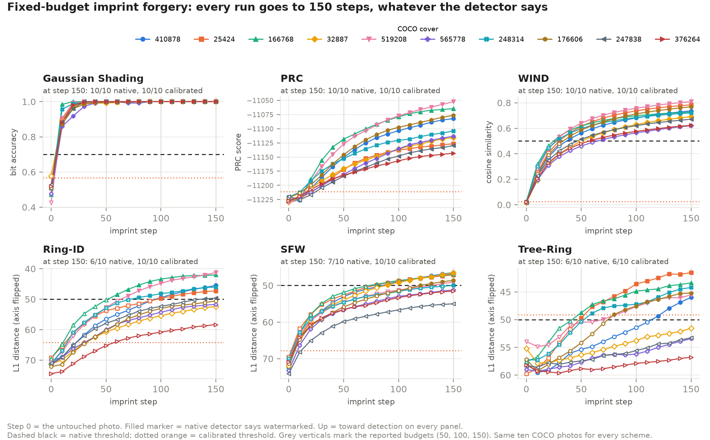
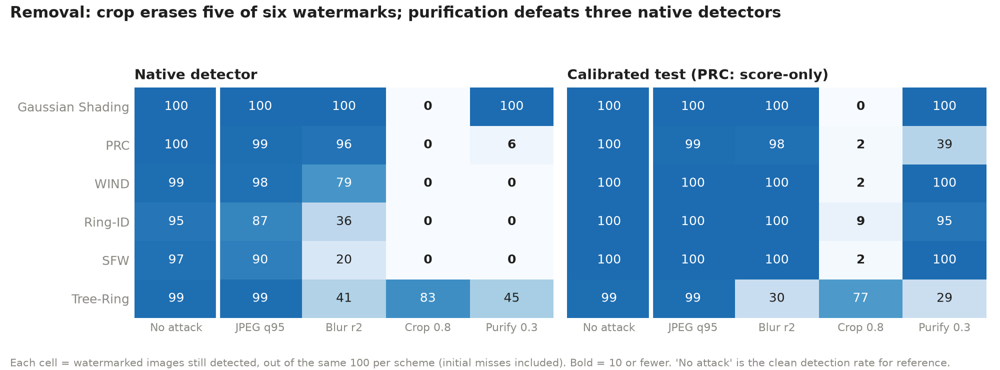

# Forging the Watermark: Benchmarking False Attribution in Semantic Watermarks for Diffusion Models

CMPE 261 (Generative AI), San José State University, Fall 2026. Team project.

Semantic watermarks for diffusion models are tested almost entirely against removal. This project measures the opposite failure: how often an attacker can make an innocent real photograph verify as watermarked.

## Findings so far (Check-in 3)

All six core semantic schemes on Stable Diffusion 2.1-base, at full size: 100 watermarked, 200 unwatermarked and 100 real COCO images per scheme for the baselines; imprint forgery (Mueller et al., CVPR 2025) with the provider's own model on ten real photographs per scheme, run to a fixed 150-step budget and scored at steps 50, 100 and 150; and four removal attacks on 100 watermarked images per scheme. Every result is given at the toolkit's native threshold and at a threshold calibrated to 1% false positives on the 200 unwatermarked images. 5,700 measurements in [`results/checkin3/full/`](results/checkin3/full/).

| Scheme | Clean TPR / FPR generated / FPR real (native) | Forged at step 150, native / calibrated | Removal (native / calibrated, of 100): JPEG · blur · crop · purification |
|---|---|---|---|
| Gaussian Shading | 100/100 · 0/200 · 0/100 | 10/10 / 10/10 | 100/100 · 100/100 · 0/0 · 100/100 |
| PRC | 100/100 · 0/200 · 0/100 | 10/10 / 10/10 | 99/99 · 96/98 · 0/2 · 6/39 |
| WIND | 99/100 · 0/200 · 0/100 | 10/10 / 10/10 | 98/100 · 79/100 · 0/2 · 0/100 |
| Tree-Ring | 99/100 · 8/200 · 2/100 | 6/10 / 6/10 | 99/99 · 41/30 · 83/77 · 45/29 |
| Ring-ID | 95/100 · 0/200 · 0/100 | 6/10 / 10/10 | 87/100 · 36/100 · 0/9 · 0/95 |
| SFW | 97/100 · 0/200 · 0/100 | 7/10 / 10/10 | 90/100 · 20/100 · 0/2 · 0/100 |

- **Every core scheme can be forged, but not every photograph.** Gaussian Shading, PRC and WIND accepted all ten forgeries; Tree-Ring, Ring-ID and SFW six or seven at the native threshold.
- **For Ring-ID and SFW the native threshold hides how far the forgery got.** Under the calibrated test both reach 10/10.
- **Damage depends on the budget and the photograph, not the scheme:** about 22.2, 21.1 and 20.4 dB PSNR at steps 50, 100 and 150 for every scheme.
- **Crop-and-rescale removes five of six watermarks**; only Tree-Ring survives it. **Purification defeats the native detectors** of Ring-ID, SFW and WIND, while their calibrated scores still detect 95 to 100 of 100.
- **Ten covers still give wide intervals** (10/10 is 72% to 100% at 95% confidence).

The full write-up, with method, algorithms, cost, problems found and every confidence interval, is the Check-in 3 report: [`docs/Group6_CMPE261_CheckIn_3.pdf`](docs/Group6_CMPE261_CheckIn_3.pdf) (source [`docs/checkin-3.md`](docs/checkin-3.md)). Earlier results: Check-in 1 ([`docs/checkin-1.md`](docs/checkin-1.md)) and Check-in 2 ([`docs/CMPE261_CheckIn2_Group6.pdf`](docs/CMPE261_CheckIn2_Group6.pdf)), whose logs stay in [`results/checkin1/`](results/checkin1/), [`results/tr150/`](results/tr150/) and [`results/checkin2/`](results/checkin2/).

## Status

Against the commitments in [`docs/project-spec.md`](docs/project-spec.md):

- **F1, clean and real-photo baselines:** done for 6 of 6 core schemes at full size (100 / 200 / 100); all six pass the inclusion rule.
- **F2, imprint forgery, same-model attacker:** done for 6 of 6 core schemes, 10 covers each, fixed budgets of 50, 100 and 150 steps.
- **F3, removal robustness:** done for 6 of 6 core schemes, four attacks on 100 watermarked images each.
- **Next:** forgery with Stable Diffusion 1.5 as the attacker (C2), strength sweeps for crop and purification, up to three extended schemes.

Measured cost per imprint step: 4.8 s on an NVIDIA RTX PRO 6000, 18.6 s on an NVIDIA L4, 8.2 to 8.4 s on an NVIDIA A100 40 GB. The last 38 forgery covers and all removal runs took one 17-hour A100 job on the SJSU CoE HPC cluster.

## Team

- Kanaka Sarat Siripurapu
- Latha Boralingaiah
- Yashashav Devalapalli Kamalraj

Shared Google Drive folder (team, instructor, and TA have access): [CMPE261 Group 6 - Forging the Watermark](https://drive.google.com/drive/folders/1wkXOxPjfI648JPod1Fi2m9ItfrPvWVIT)

## Documents

| Document | Contents |
|---|---|
| [`docs/project-spec.md`](docs/project-spec.md) | Finalized specification, tentative abstract, report outline |
| [`docs/checkin-1.md`](docs/checkin-1.md) | Data exploration, first results, 150-step follow-up |
| [`docs/checkin-2.md`](docs/checkin-2.md) | Literature survey, approach, algorithms, draft report sections, check-in log |
| [`docs/CMPE261_CheckIn2_Group6.pdf`](docs/CMPE261_CheckIn2_Group6.pdf) | Check-in 2 report: baselines and forgery for all six core schemes |
| [`docs/Group6_CMPE261_CheckIn_3.pdf`](docs/Group6_CMPE261_CheckIn_3.pdf) | Check-in 3 report: full baselines, fixed-budget forgery and removal for all six core schemes |
| [`docs/checkin-3.md`](docs/checkin-3.md) | Source of the Check-in 3 report |
| [`data/README.md`](data/README.md) | Data sources and committed selections |

## Layout

| Path | Purpose |
|---|---|
| `src/wmforge/` | Harness over MarkDiffusion, imprint forgery attack, metrics, run log, runner, report |
| `tests/` | Unit tests |
| `scripts/` | Data selection; combined figure across runs; Check-in 2 and 3 figures (`checkin2_figures.py`, `checkin3_figures.py`); Check-in 3 PDF (`checkin3_pdf.py`) |
| `notebooks/01_smoke_colab.ipynb` | Check-in 1 experiment on Colab |
| `notebooks/02_checkin2_colab.ipynb` | Check-in 2 run on Colab (Ring-ID, SFW, WIND, PRC), kept with its outputs |
| `results/checkin1/` | Check-in run: log, summary table, figures (both schemes, 60-step cap) |
| `results/tr150/` | Tree-Ring rerun with a 150-step cap |
| `results/checkin2/` | Check-in 2 run: log, per-cover forgery table, figures (four new schemes, 150-step cap) |
| `notebooks/03_checkin3_colab.ipynb` | Check-in 3 run on Colab: setup, preflight, monitoring, backup |
| `results/checkin3/full/` | Check-in 3 run: 5,700-row log, calibrations, manifest, environment, summaries, figures, cluster verification records |
| `results/figures/` | Figures that combine runs |

## Running

Tests, on any machine:

    uv venv --python 3.12 .venv
    uv pip install --python .venv/bin/python -e ".[dev,attack]"
    .venv/bin/python -m pytest

The experiment needs a GPU. Open `notebooks/01_smoke_colab.ipynb` (Check-in 1) or `notebooks/02_checkin2_colab.ipynb` (Check-in 2) in Colab and run the cells in order. SFW needs `qrcode`, and PRC needs `galois` and `ldpc<2`; MarkDiffusion does not install them, so the Check-in 2 notebook does:

    pip install qrcode galois "ldpc<2"

The Check-in 2 runs:

    python -m wmforge.smoke --out results/checkin2 --schemes RI SFW WIND PRC --stages clean real
    python -m wmforge.smoke --out results/checkin2 --schemes RI SFW WIND PRC --stages imprint --n-covers 5 --max-steps 150
 For a different step cap, run the runner directly on the VM:

    python -m wmforge.smoke --out results/tr150 --schemes TR --stages real imprint --n-real 5 --n-covers 5 --max-steps 150
    python -m wmforge.report --run results/tr150

The earlier combined figure (`results/figures/trajectories.png`) comes from:

    python scripts/combined_figure.py GS=results/checkin1 TR=results/tr150 --out results/figures/trajectories.png

The Check-in 2 figures, across all six schemes (no GPU needed):

    python scripts/checkin2_figures.py results/checkin2/runs.csv results/checkin1/runs.csv results/tr150/runs.csv results/checkin2/figures

The Check-in 3 benchmark (GPU; resumes from its checkpoints), then its summary, figures and PDF (no GPU needed):

    python -m wmforge.preflight --out PILOT_DIR
    python -m wmforge.checkin3 --out RUN_DIR --preflight PILOT_DIR/preflight.json
    python -m wmforge.checkin3_report --run RUN_DIR
    python scripts/checkin3_figures.py --run results/checkin3/full --out results/checkin3/full/figures
    python scripts/checkin3_pdf.py

## License and attribution

GPL-3.0; see `LICENSE`. The imprint attack in `src/wmforge/imprint.py` is adapted from [and-mill/semantic-forgery](https://github.com/and-mill/semantic-forgery) (Müller et al., CVPR 2025), which is GPL-3.0. Watermarking schemes and detectors come from [MarkDiffusion](https://github.com/THU-BPM/MarkDiffusion) (Apache-2.0).
