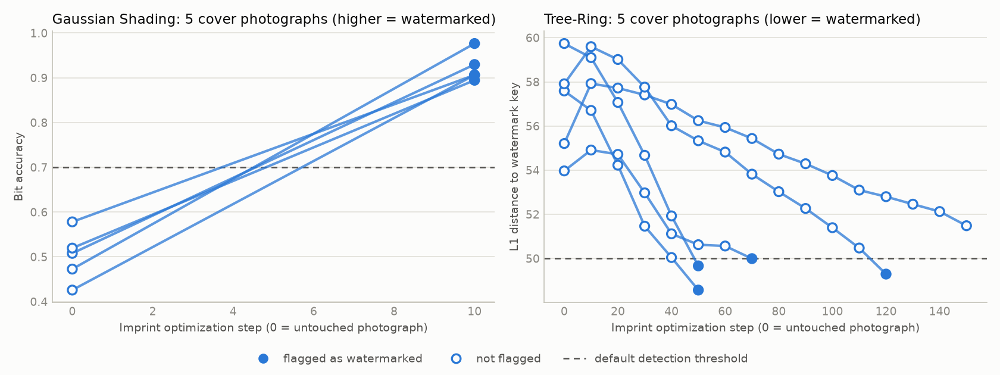

# Forging the Watermark: Benchmarking False Attribution in Semantic Watermarks for Diffusion Models

CMPE 261 (Generative AI), San José State University, Fall 2026. Team project.

Semantic watermarks for diffusion models are tested almost entirely against removal. This project measures the opposite failure: how often an attacker can make an innocent real photograph verify as watermarked.

## Findings so far

Six semantic schemes on Stable Diffusion 2.1-base, attacked with the provider's own model (the strongest case), five real COCO photographs per scheme. The attack is the imprint forgery of Müller et al. (CVPR 2025): optimize the photograph until its inverted noise matches that of a watermarked image. Runs stop at first detection, with a cap of 60 steps for Gaussian Shading and 150 for the rest.

| Scheme | Clean detection: TPR / FPR generated / FPR real photos | Covers forged | Stop step, median (range) | PSNR at stop, median (range) |
|---|---|---|---|---|
| Gaussian Shading | 50/50 / 0/50 / 0/50 | 5/5 | 10 (10 to 10) | 28.6 dB (22.7 to 31.8) |
| PRC | 50/50 / 0/50 / 0/50 | 5/5 | 20 (20 to 30) | 27.7 dB (22.0 to 30.5) |
| WIND | 50/50 / 0/50 / 0/50 | 5/5 | 30 (30 to 50) | 27.0 dB (21.2 to 29.4) |
| Ring-ID | 49/50 / 0/50 / 0/50 | 5/5 | 70 (50 to 120) | 26.0 dB (20.1 to 27.9) |
| SFW | 49/50 / 0/50 / 0/50 | 5/5 | 90 (80 to 140) | 25.1 dB (20.0 to 27.3) |
| Tree-Ring | 50/50 / 2/50 / 0/50 | 4/5 | 70 (50 to 150) | 26.0 dB (19.6 to 28.4) |

- **All six schemes pass the inclusion rule** on clean images, and **every scheme was forged on every photograph except Tree-Ring**, which resisted on one at the 150-step cap.
- **Key-based schemes fell fastest.** Gaussian Shading and PRC verified within 10 to 30 steps; the pattern-based schemes needed 50 to 150. Ring-ID and SFW crossed their threshold only narrowly, and repeated runs differ by about 0.3, so those verdicts are near coin flips.
- **Five covers give wide intervals** (5/5 is 57% to 100%, 4/5 is 38% to 96% at 95% confidence), so the ordering above is by step count, not by success rate. The next milestone uses 10 covers and fixed step budgets instead of stopping at first detection.

Full table with intervals and the per-cover breakdown: [`results/figures/summary_six_schemes.md`](results/figures/summary_six_schemes.md).

*Detector score for each cover photograph as the imprint proceeds for the two Check-in 1 schemes. Step 0 is the untouched photograph; a filled marker means the detector flagged the image as watermarked.*

Method, limits, cost, and problems found: [`docs/checkin-1.md`](docs/checkin-1.md) and [`docs/checkin-2.md`](docs/checkin-2.md). Run logs: [`results/checkin1/`](results/checkin1/), [`results/tr150/`](results/tr150/), [`results/checkin2/`](results/checkin2/).

## Status

Against the commitments in [`docs/project-spec.md`](docs/project-spec.md):

- **F1, clean and real-photo baselines:** 6 of 6 core schemes done at 50 images per cell (spec: 100 watermarked, 200 unwatermarked, 100 real).
- **F2, imprint forgery, same-model attacker:** 6 of 6 core schemes done at 5 covers, stop at first detection (spec: 10 covers, fixed step budgets).
- **F3, removal robustness:** not started.

Measured cost: 4.9 s per imprint step on an NVIDIA RTX PRO 6000, 8.4 s on an A100; 4 to 6 s per generation.

## Team

- Kanaka Sarat Siripurapu
- Latha Boralingaiah
- Yashashav Devalapalli Kamalraj

Shared Google Drive folder (team, instructor, and TA have access): [CMPE261 Group 6 - Forging the Watermark](https://drive.google.com/drive/folders/1wkXOxPjfI648JPod1Fi2m9ItfrPvWVIT)

## Documents

| Document | Contents |
|---|---|
| [`docs/project-spec.md`](docs/project-spec.md) | Finalized specification, tentative abstract, report outline |
| [`docs/checkin-1.md`](docs/checkin-1.md) | Data exploration, first results, 150-step follow-up |
| [`docs/checkin-2.md`](docs/checkin-2.md) | Literature survey, approach, algorithms, draft report sections, check-in log |
| [`data/README.md`](data/README.md) | Data sources and committed selections |

## Layout

| Path | Purpose |
|---|---|
| `src/wmforge/` | Harness over MarkDiffusion, imprint forgery attack, metrics, run log, runner, report |
| `tests/` | Unit tests |
| `scripts/` | Data selection; combined figure, combined summary, and Check-in 2 figures from the run logs |
| `notebooks/01_smoke_colab.ipynb` | Check-in 1 experiment on Colab |
| `results/checkin1/` | Check-in run: log, summary table, figures (both schemes, 60-step cap) |
| `results/tr150/` | Tree-Ring rerun with a 150-step cap |
| `results/checkin2/` | Check-in 2 run: baselines and imprint forgery for Ring-ID, SFW, WIND, PRC |
| `notebooks/02_checkin2_colab.ipynb` | Check-in 2 experiment on Colab |
| `results/figures/` | Figures that combine runs |

## Running

Tests, on any machine:

    uv venv --python 3.12 .venv
    uv pip install --python .venv/bin/python -e ".[dev,attack]"
    .venv/bin/python -m pytest

The experiment needs a GPU. Open `notebooks/01_smoke_colab.ipynb` in Colab and run the cells in order. For a different step cap, run the runner directly on the VM:

    python -m wmforge.smoke --out results/tr150 --schemes TR --stages real imprint --n-real 5 --n-covers 5 --max-steps 150
    python -m wmforge.report --run results/tr150

The combined figure above comes from:

    python scripts/combined_figure.py GS=results/checkin1 TR=results/tr150 --out results/figures/trajectories.png

The three Check-in 2 figures in `results/checkin2/figures/` come from the committed run logs and need no GPU:

    python scripts/checkin2_figures.py

The six-scheme summary table comes from (a `SCHEME:stage=dir` entry takes only those stages from that run):

    python scripts/combined_summary.py GS=results/checkin1 TR:clean,real=results/checkin1 TR:imprint=results/tr150 RI=results/checkin2 SFW=results/checkin2 WIND=results/checkin2 PRC=results/checkin2 --out results/figures/summary_six_schemes.md

## License and attribution

GPL-3.0; see `LICENSE`. The imprint attack in `src/wmforge/imprint.py` is adapted from [and-mill/semantic-forgery](https://github.com/and-mill/semantic-forgery) (Müller et al., CVPR 2025), which is GPL-3.0. Watermarking schemes and detectors come from [MarkDiffusion](https://github.com/THU-BPM/MarkDiffusion) (Apache-2.0).
