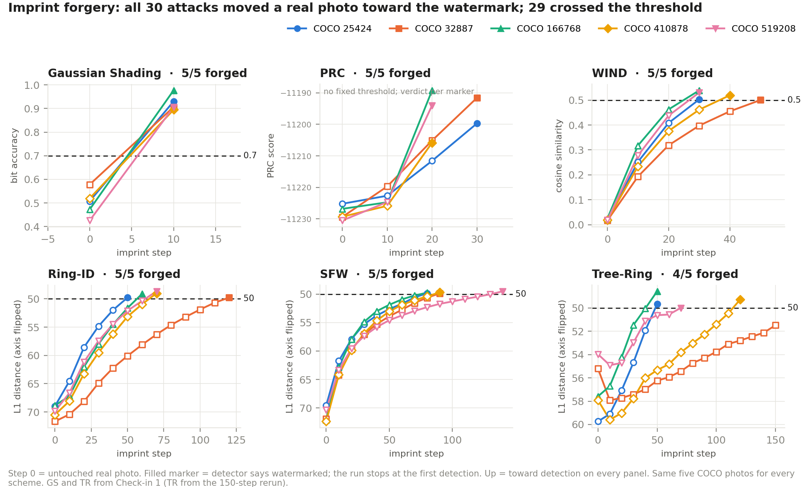
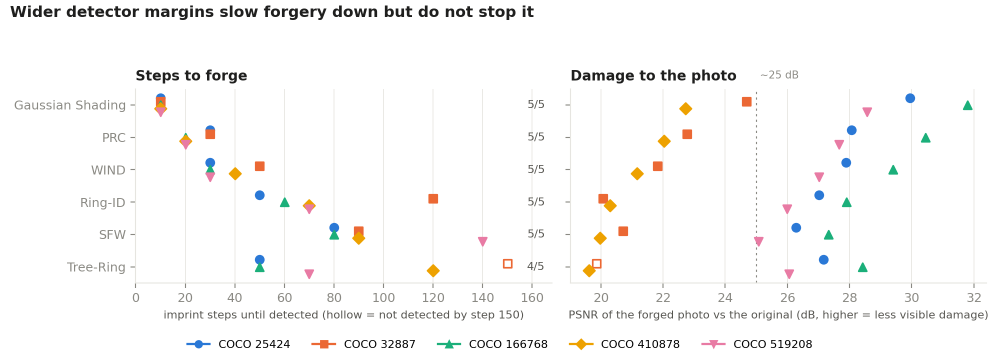

# Forging the Watermark: Benchmarking False Attribution in Semantic Watermarks for Diffusion Models

CMPE 261 (Generative AI), San José State University, Fall 2026. Team project.

Semantic watermarks for diffusion models are tested almost entirely against removal. This project measures the opposite failure: how often an attacker can make an innocent real photograph verify as watermarked.

## Findings so far

All six core semantic schemes on Stable Diffusion 2.1-base, attacked with the provider's own model (the strongest case), five real COCO photographs per scheme, 150-step cap, detector checked every 10 steps. The attack is the imprint forgery of Müller et al. (CVPR 2025): optimize the photograph until its inverted noise matches that of a watermarked image.

| Scheme | Clean detection: TPR / FPR generated / FPR real photos | Forged | Steps to first detection (median) | PSNR of forgeries (median) |
|---|---|---|---|---|
| Gaussian Shading | 50/50 / 0/50 / 0/50 | 5/5 | 10 | 27.5 dB (mean) |
| PRC | 50/50 / 0/50 / 0/50 | 5/5 | 20 | 27.7 dB |
| WIND | 50/50 / 0/50 / 0/50 | 5/5 | 30 | 27.0 dB |
| Ring-ID | 49/50 / 0/50 / 0/50 | 5/5 | 70 | 26.0 dB |
| SFW | 49/50 / 0/50 / 0/50 | 5/5 | 90 | 25.1 dB |
| Tree-Ring | 50/50 / 2/50 / 0/50 | 4/5 | 60 (of the four forged) | 24.2 dB (mean) |

- **Every core scheme was forged.** 29 of 30 attacks turned a real photograph into one the provider's detector calls watermarked. The one miss is a Tree-Ring cover still moving toward the threshold at 150 steps.
- **PRC and WIND fell fastest among the new schemes** (20 to 50 steps), despite PRC's undetectability proof and WIND's salted noise.
- **Wider margins slow the attack but do not stop it.** Real photographs start about 15 to 24 units from the Ring-ID and SFW threshold, against 0.4 to 11 for Tree-Ring. Ring-ID and SFW needed 3 to 4 times as many steps as PRC or WIND and still fell on every cover.
- **Close calls.** Ring-ID and SFW forgeries were flagged at 48.7 to 49.9 against a threshold of 50, the same thin margin that made Tree-Ring verdicts flip between runs.
- **Five covers give wide intervals** (5/5 is 57% to 100% at 95% confidence). The next milestone uses 10 covers and fixed step budgets instead of stopping at first detection.

*Detector score for each cover photograph as the imprint proceeds. Step 0 is the untouched photograph; up means closer to being flagged; a filled marker means the detector flagged the image. Gaussian Shading and Tree-Ring from Check-in 1 (Tree-Ring from the 150-step run), the other four from Check-in 2.*

Method, limits, cost, and problems found: [`docs/checkin-1.md`](docs/checkin-1.md) and the Check-in 2 report [`docs/CMPE261_CheckIn2_Group6.pdf`](docs/CMPE261_CheckIn2_Group6.pdf). Run logs: [`results/checkin1/`](results/checkin1/), [`results/tr150/`](results/tr150/) and [`results/checkin2/`](results/checkin2/).

## Status

Against the commitments in [`docs/project-spec.md`](docs/project-spec.md):

- **F1, clean and real-photo baselines:** 6 of 6 core schemes done at 50 images per cell; all six pass the inclusion rule (spec: 100 watermarked, 200 unwatermarked, 100 real).
- **F2, imprint forgery, same-model attacker:** 6 of 6 core schemes done at 5 covers with stop-at-first-detection (spec: 10 covers, fixed step budgets).
- **F3, removal robustness:** not started.

Measured cost: 4.9 s per imprint step on one NVIDIA RTX PRO 6000 (Check-in 1); 8.4 s per imprint step and about 7 s per generation plus detection on one NVIDIA A100 40 GB (Check-in 2).

## Team

- Kanaka Sarat Siripurapu
- Latha Boralingaiah
- Yashashav Devalapalli Kamalraj

Shared Google Drive folder (team, instructor, and TA have access): [CMPE261 Group 6 - Forging the Watermark](https://drive.google.com/drive/folders/1wkXOxPjfI648JPod1Fi2m9ItfrPvWVIT)

## Documents

| Document | Contents |
|---|---|
| [`docs/project-spec.md`](docs/project-spec.md) | Finalized specification, tentative abstract, report outline |
| [`docs/checkin-1.md`](docs/checkin-1.md) | Data exploration, first results, 150-step follow-up |
| [`docs/checkin-2.md`](docs/checkin-2.md) | Literature survey, approach, algorithms, draft report sections, check-in log |
| [`docs/CMPE261_CheckIn2_Group6.pdf`](docs/CMPE261_CheckIn2_Group6.pdf) | Check-in 2 report: baselines and forgery for all six core schemes |
| [`data/README.md`](data/README.md) | Data sources and committed selections |

## Layout

| Path | Purpose |
|---|---|
| `src/wmforge/` | Harness over MarkDiffusion, imprint forgery attack, metrics, run log, runner, report |
| `tests/` | Unit tests |
| `scripts/` | Data selection; combined figure across runs; Check-in 2 figures (`checkin2_figures.py`) |
| `notebooks/01_smoke_colab.ipynb` | Check-in 1 experiment on Colab |
| `notebooks/02_checkin2_colab.ipynb` | Check-in 2 run on Colab (Ring-ID, SFW, WIND, PRC), kept with its outputs |
| `results/checkin1/` | Check-in run: log, summary table, figures (both schemes, 60-step cap) |
| `results/tr150/` | Tree-Ring rerun with a 150-step cap |
| `results/checkin2/` | Check-in 2 run: log, per-cover forgery table, figures (four new schemes, 150-step cap) |
| `results/figures/` | Figures that combine runs |

## Running

Tests, on any machine:

    uv venv --python 3.12 .venv
    uv pip install --python .venv/bin/python -e ".[dev,attack]"
    .venv/bin/python -m pytest

The experiment needs a GPU. Open `notebooks/01_smoke_colab.ipynb` (Check-in 1) or `notebooks/02_checkin2_colab.ipynb` (Check-in 2) in Colab and run the cells in order. SFW needs `qrcode`, and PRC needs `galois` and `ldpc<2`; MarkDiffusion does not install them, so the Check-in 2 notebook does:

    pip install qrcode galois "ldpc<2"

The Check-in 2 runs:

    python -m wmforge.smoke --out results/checkin2 --schemes RI SFW WIND PRC --stages clean real
    python -m wmforge.smoke --out results/checkin2 --schemes RI SFW WIND PRC --stages imprint --n-covers 5 --max-steps 150
 For a different step cap, run the runner directly on the VM:

    python -m wmforge.smoke --out results/tr150 --schemes TR --stages real imprint --n-real 5 --n-covers 5 --max-steps 150
    python -m wmforge.report --run results/tr150

The combined figure above comes from:

    python scripts/combined_figure.py GS=results/checkin1 TR=results/tr150 --out results/figures/trajectories.png

The Check-in 2 figures, across all six schemes (no GPU needed):

    python scripts/checkin2_figures.py results/checkin2/runs.csv results/checkin1/runs.csv results/tr150/runs.csv results/checkin2/figures

## License and attribution

GPL-3.0; see `LICENSE`. The imprint attack in `src/wmforge/imprint.py` is adapted from [and-mill/semantic-forgery](https://github.com/and-mill/semantic-forgery) (Müller et al., CVPR 2025), which is GPL-3.0. Watermarking schemes and detectors come from [MarkDiffusion](https://github.com/THU-BPM/MarkDiffusion) (Apache-2.0).
