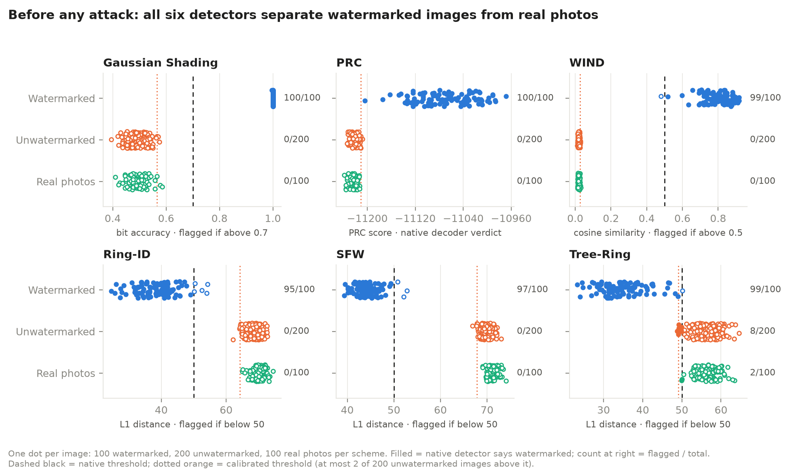
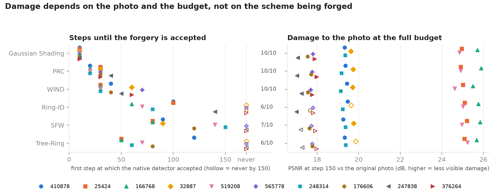
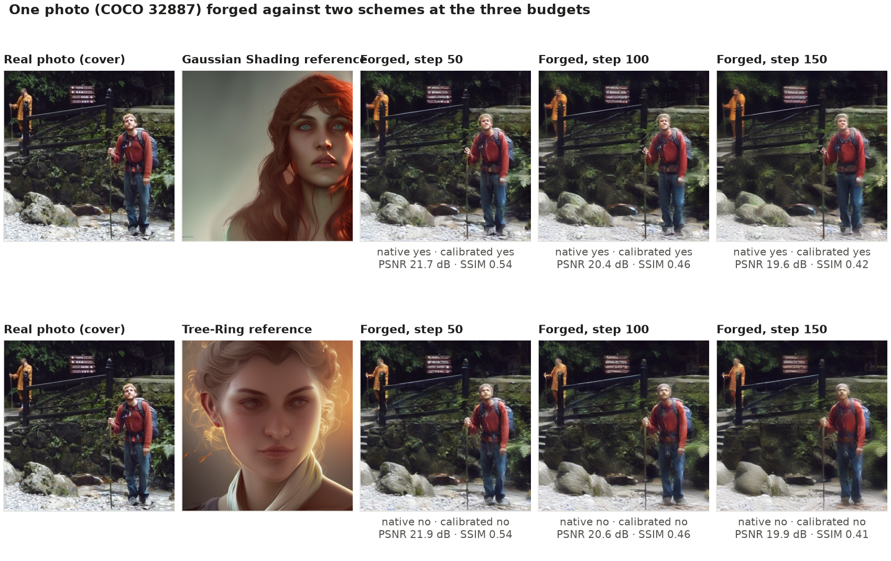
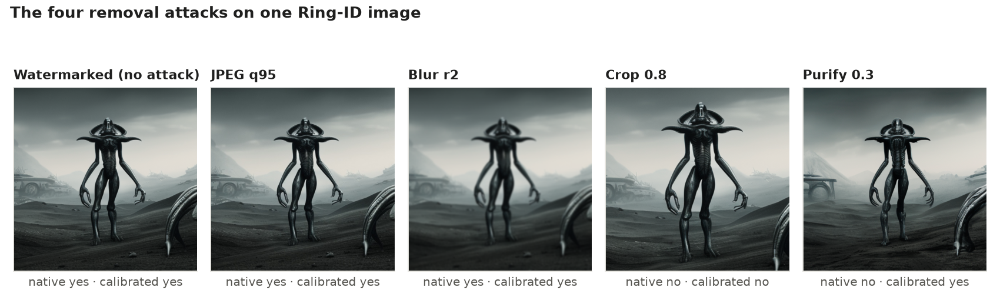
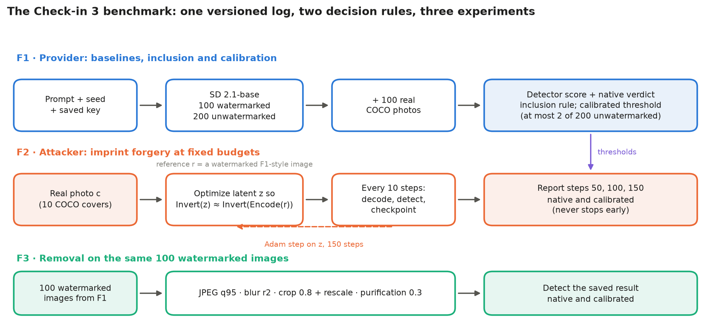

# Check-in 3

<p class="subtitle">Forging the Watermark: Benchmarking False Attribution in Semantic Watermarks for Diffusion Models</p>

CMPE 261 Sec 01, Fall 2026. Group 6. Team: Kanaka Sarat Siripurapu (019132776), Latha Boralingaiah (018301361), Yashashav Devalapalli Kamalraj (017856371).

Repository: <https://github.com/yashashav-dk/cmpe261-watermark-forgery>

Shared Drive folder: <https://drive.google.com/drive/folders/1wkXOxPjfI648JPod1Fi2m9ItfrPvWVIT>

The instructor and the TA have Editor access to the Drive folder. The repository is public, so both can open it; the instructor (rudolfbertin) also has write access.

## 1. Where each requirement is met

| Requirement | Status | Where |
|---|---|---|
| Initial draft of the project (recommended) | Done: results, method, algorithms, abstract, outline and survey are written as report sections | Sections 3 to 7 |
| Tentative abstract (required) | Done, rewritten with this check-in's results | Section 7.1 |
| Outline of the report (recommended) | Done | Section 7.2 |
| Literature survey (required) | Done, updated | Section 7.3 |
| Approach (required) | Completed: the full benchmark protocol is built and was run end to end | Sections 5 and 6 |
| Theoretical / experimental results (required) | Done: full-size baselines, fixed-budget forgery and removal for all six core schemes, 5,700 measurements | Section 3 |
| Meaningful check-ins, about 8 to 10 (required) | 12 commits since Check-in 2, four by each member | Section 8.1 and the repository history |
| Instructor and TA invited (required) | Drive: both have Editor access. GitHub: public repository, open to both; instructor also has write access | Top of this document |
| Repository and Drive link in the report (required) | Done | Top of this document |
| Draft of the final report (recommended) | This document; source in `docs/checkin-3.md` | Repository |

## 2. Where Check-in 2 left off

Check-in 2 ran all six core schemes at check-in scale (50 images per baseline cell, five covers, stop at the first detection) and ended with four next steps, in the order fixed by the specification:

| # | Next step from Check-in 2 | Status at Check-in 3 |
|---|---|---|
| 1 | Bring the baselines to full size (100 watermarked, 200 unwatermarked, 100 real per scheme) and compute the 1% false-positive thresholds | **Done for all six** (Section 3.1). All six pass the inclusion rule. |
| 2 | Imprint forgery for the six core schemes, 10 covers each, run to fixed budgets of 50, 100 and 150 steps without stopping at detection | **Done for all six** (Section 3.2): 60 trajectories, every one run to step 150. |
| 3 | Removal robustness under the four MarkDiffusion attacks, 100 watermarked images per scheme and attack | **Done for all six** (Section 3.3): 2,400 attacked images. |
| 4 | Imprint forgery with Stable Diffusion 1.5 as the attacker (condition C2) | Not started. Moved to the final report (Section 9). |

The model and revision, the MarkDiffusion commit, the attack code and the detector thresholds are the same as in Check-in 2. The prompts and photographs were extended from 50 to 200 and 100 with the original 50 kept as the first entries, and the forgery covers from 5 to 10 with the original five kept first. Two things changed on purpose. Every forgery now runs to its full 150-step budget and is scored at steps 50, 100 and 150, so the result no longer depends on stopping when the detector agrees. And every measurement goes into a new versioned log that refuses to mix runs with different code, keys, inputs or environment.

One more change was a side effect. Each scheme's watermark key is now drawn once from a fixed seed and saved with the run, which the earlier check-ins did not do. On the shared prompts, Gaussian Shading, WIND and PRC reproduce the earlier watermarked and unwatermarked scores, but Tree-Ring, Ring-ID and SFW do not, so those three keys differ from the earlier ones. Of those three, only Ring-ID's forgery steps moved on the five shared covers (cover 25424: step 50 to 100; 410878: 70 to 100; 32887: 120 to not accepted by 150); Tree-Ring and SFW needed exactly the same number of steps as before.

**Data.** No new sources were added; the Check-in 1 selections were extended with seed 261, keeping the earlier items first (`data/checkin3-selection.json` records the pools and hashes).

| Source | Use | Size used |
|---|---|---|
| Stable-Diffusion-Prompts, eval split (bundled with MarkDiffusion) | Prompts for generated images | 200 prompts; the first 50 are the Check-in 1 and 2 prompts |
| MS-COCO val2017 | Real photographs: real-photo negatives and forgery covers | 100 photographs; the first 10 are the covers, the first 5 the Check-in 2 covers |
| Stable Diffusion 2.1-base, community mirror pinned by commit | Target model, same-model attacker, purification | one model |

Check-in 2 named Colab quota as the main risk, and it was. The run started on Colab, lost its runtime partway through forgery, and finished on the SJSU CoE HPC cluster with the saved state carried over intact (Section 3.6).

## 3. Results

Stable Diffusion 2.1-base at 512×512, 50 sampling and inversion steps, guidance 7.5, full precision, each scheme at its MarkDiffusion default configuration. Brackets are 95% Wilson intervals; continuous metrics carry 10,000-resample bootstrap intervals. The full log is `results/checkin3/full/measurements-v2.json` (5,700 rows). Every number below is recomputed from it by `python -m wmforge.checkin3_report` and `scripts/checkin3_figures.py`.

### 3.1 Clean baseline and real-photo baseline (F1)

Table 1 gives the native results and Table 2 the calibrated ones; Figure 1 shows every score.

<p class="tcap">Table 1. Native detection on the two baselines.</p>

| Scheme | Detector score | TPR, watermarked | FPR, unwatermarked | FPR, real photos | Passes inclusion rule |
|---|---|---|---|---|---|
| Gaussian Shading | bit accuracy, above 0.7 | 100/100 = 100% [96%, 100%] | 0/200 = 0% [0%, 2%] | 0/100 = 0% [0%, 4%] | yes |
| PRC | decoder verdict | 100/100 = 100% [96%, 100%] | 0/200 = 0% [0%, 2%] | 0/100 = 0% [0%, 4%] | yes |
| WIND | cosine similarity, above 0.5 | 99/100 = 99% [95%, 100%] | 0/200 = 0% [0%, 2%] | 0/100 = 0% [0%, 4%] | yes |
| Ring-ID | L1 distance, below 50 | 95/100 = 95% [89%, 98%] | 0/200 = 0% [0%, 2%] | 0/100 = 0% [0%, 4%] | yes |
| SFW | L1 distance, below 50 | 97/100 = 97% [92%, 99%] | 0/200 = 0% [0%, 2%] | 0/100 = 0% [0%, 4%] | yes |
| Tree-Ring | L1 distance, below 50 | 99/100 = 99% [95%, 100%] | 8/200 = 4% [2%, 8%] | 2/100 = 2% [1%, 7%] | yes, close to the limit |

<p class="note">Native decisions at MarkDiffusion's default thresholds; every logged verdict agrees with them. The inclusion rule from the specification is TPR ≥ 90% and FPR ≤ 5% on unwatermarked generations.</p>

The calibrated threshold for each scheme is set on the 200 unwatermarked scores alone, so that at most 2 of them (1%) lie beyond it:

<p class="tcap">Table 2. Calibrated thresholds and their detection rates.</p>

| Scheme | Calibrated threshold | TPR, watermarked | FPR, unwatermarked (by construction) | FPR, real photos |
|---|---|---|---|---|
| Gaussian Shading | bit accuracy above 0.566 | 100/100 | 2/200 | 2/100 = 2% [1%, 7%] |
| PRC (score-only test) | PRC score above −11211.0 | 100/100 | 2/200 | 0/100 |
| WIND | cosine similarity above 0.027 | 100/100 | 2/200 | 4/100 = 4% [2%, 10%] |
| Ring-ID | L1 distance below 64.2 | 100/100 | 2/200 | 0/100 |
| SFW | L1 distance below 67.8 | 100/100 | 2/200 | 0/100 |
| Tree-Ring | L1 distance below 49.1 | 99/100 | 2/200 | 0/100 |

<figure>

<figcaption>Figure 1. Every detector score from the two baselines, one dot per image (400 per scheme). A filled dot means the native detector flagged the image. Dashed black: native threshold. Dotted orange: calibrated threshold.</figcaption>
</figure>

**All six core schemes enter the benchmark at full size.** Five of them flag no unwatermarked generation and no real photograph. Ring-ID and SFW miss 5 and 3 watermarked images at the native threshold of 50, but their calibrated thresholds sit far out at 64 and 68 because their unwatermarked scores never come close to 50. Under the calibrated test they detect all 100.

**Tree-Ring is the exception, as in Check-in 2.** Its unwatermarked scores start right at the threshold: 8 of 200 fell just below 50, and 2 of 100 real photographs did too. That is 4% against a 5% limit, so Tree-Ring passes, but narrowly. Its calibrated threshold is 49.1, slightly stricter than the native 50.

**Calibration on generated images does not carry over exactly to photographs.** The calibrated tests for Gaussian Shading and WIND flag 2 and 4 of 100 real photographs, against 2 of 200 generated ones. Real photographs are where the forgery attack starts, so these are the false-positive rates that matter for false attribution, and we report them next to every calibrated result.

### 3.2 Fixed-budget imprint forgery (F2)

The attack is the Check-in 2 imprint forgery with one change: it never stops early. Each of the ten covers gets its own watermarked reference, runs for 150 steps, and is scored every ten steps. The primary results use the saved images at steps 50, 100 and 150 (Table 3 and Figure 2).

<p class="tcap">Table 3. Forged photographs accepted at each budget.</p>

| Scheme | Step 50, native | Step 50, calibrated | Step 100, native | Step 100, calibrated | Step 150, native | Step 150, calibrated | Median first acceptance (native) |
|---|---|---|---|---|---|---|---|
| Gaussian Shading | 10/10 | 10/10 | 10/10 | 10/10 | 10/10 [72%, 100%] | 10/10 | step 10 |
| PRC | 10/10 | 10/10 | 10/10 | 10/10 | 10/10 [72%, 100%] | 10/10 | step 30 (20 to 40) |
| WIND | 7/10 | 10/10 | 10/10 | 10/10 | 10/10 [72%, 100%] | 10/10 | step 40 (30 to 70) |
| Tree-Ring | 2/10 | 1/10 | 5/10 | 5/10 | 6/10 [31%, 83%] | 6/10 | step 65 (50 to 120) |
| Ring-ID | 0/10 | 9/10 | 5/10 | 10/10 | 6/10 [31%, 83%] | 10/10 | step 90 (60 to 140) |
| SFW | 0/10 | 10/10 | 4/10 | 10/10 | 7/10 [40%, 89%] | 10/10 | step 90 (80 to 150) |

<p class="note">Forged photographs accepted, out of 10 covers. "Median first acceptance" is a secondary diagnostic over the covers the native detector accepted by step 150, with the range in brackets. The PRC calibrated columns are the separate score-only test, not the PRC decoder.</p>

Table 4 gives, per cover, the first step at which each rule accepted the forgery.

<p class="tcap">Table 4. First accepted step per cover (native / calibrated; "–" = not by step 150).</p>

| Cover (COCO id) | Gaussian Shading | PRC | WIND | Tree-Ring | Ring-ID | SFW |
|---|---|---|---|---|---|---|
| 410878 | 10 / 10 | 20 / 20 | 40 / 10 | 120 / 130 | 100 / 30 | 90 / 10 |
| 25424 | 10 / 10 | 30 / 30 | 30 / 10 | 50 / 60 | 100 / 20 | 80 / 10 |
| 166768 | 10 / 10 | 20 / 20 | 30 / 10 | 50 / 50 | 60 / 20 | 80 / 10 |
| 32887 | 10 / 10 | 30 / 20 | 60 / 10 | – / – | – / 40 | 90 / 10 |
| 519208 | 10 / 10 | 20 / 20 | 30 / 10 | 70 / 90 | 70 / 20 | 140 / 10 |
| 565778 | 10 / 10 | 30 / 30 | 70 / 10 | – / – | – / 40 | – / 10 |
| 248314 | 10 / 10 | 20 / 20 | 30 / 10 | 60 / 60 | 80 / 20 | 150 / 10 |
| 176606 | 10 / 10 | 30 / 20 | 40 / 10 | 80 / 80 | – / 40 | 120 / 10 |
| 247838 | 10 / 10 | 40 / 30 | 50 / 10 | – / – | 140 / 30 | – / 20 |
| 376264 | 10 / 10 | 30 / 20 | 60 / 10 | – / – | – / 60 | – / 10 |

<p class="note">The first five covers are the Check-in 2 covers. No trajectory reversed: every cover accepted at step 50 or 100 was still accepted at step 150, under both rules.</p>

<figure>

<figcaption>Figure 2. Detector score of every cover photograph at every evaluated step, for all six schemes. Up means closer to being flagged on every panel. A filled marker means the native detector flagged the image.</figcaption>
</figure>

Table 5 and Figure 3 give the image quality of the forgery against the original photograph; Figure 4 shows one example.

<p class="tcap">Table 5. Image quality, mean over the ten covers.</p>

| Budget | PSNR (dB), range of the six scheme means | SSIM | LPIPS | Tree-Ring PSNR with 95% bootstrap interval |
|---|---|---|---|---|
| step 50 | 22.13 to 22.24 | 0.565 to 0.568 | 0.168 to 0.173 | 22.2 dB [20.2, 24.5] |
| step 100 | 21.04 to 21.16 | 0.511 to 0.514 | 0.219 to 0.224 | 21.2 dB [19.2, 23.3] |
| step 150 | 20.37 to 20.54 | 0.481 to 0.484 | 0.260 to 0.264 | 20.5 dB [18.7, 22.6] |

<figure>

<figcaption>Figure 3. Left: first step at which the native detector accepted each cover. Right: PSNR of the step-150 image against the original photograph. In both panels a hollow marker is a cover the native detector never accepted within 150 steps.</figcaption>
</figure>

<figure>

<figcaption>Figure 4. One cover forged against Gaussian Shading (accepted at every budget shown, first at step 10) and Tree-Ring (still rejected at step 150), with each detector's verdict and the image quality at every budget.</figcaption>
</figure>

### 3.3 Removal robustness (F3)

Each attack is applied to the same 100 watermarked images per scheme, including any image the detector missed before the attack, and the detector is run on the saved result (Table 6, Figures 5 and 6).

<p class="tcap">Table 6. Watermarked images still detected after each attack.</p>

| Scheme | JPEG, quality 95 | Gaussian blur, radius 2 | Crop 0.8 and rescale | Diffusion purification, strength 0.3 |
|---|---|---|---|---|
| Gaussian Shading | 100 / 100 | 100 / 100 | **0 / 0** | 100 / 100 |
| PRC | 99 / 99 | 96 / 98 | **0 / 2** | **6** / 39 |
| WIND | 98 / 100 | 79 / 100 | **0 / 2** | **0** / 100 |
| Tree-Ring | 99 / 99 | 41 / 30 | 83 / 77 | 45 / 29 |
| Ring-ID | 87 / 100 | 36 / 100 | **0 / 9** | **0** / 95 |
| SFW | 90 / 100 | 20 / 100 | **0 / 2** | **0** / 100 |

<p class="note">Watermarked images still detected out of 100, native / calibrated. Bold: 10 or fewer, that is, the watermark is effectively removed under that rule. 0 of 100 has Wilson interval [0%, 4%]; every interval is in the appendix.</p>

<figure>

<figcaption>Figure 5. Removal results as heat maps, with the clean detection rate for reference.</figcaption>
</figure>

<figure>

<figcaption>Figure 6. The four removal attacks applied to one Ring-ID image, with the native and calibrated verdict on each saved result.</figcaption>
</figure>

### 3.4 What the numbers show

**Every core scheme can be forged, but not every photograph.** At the full 150-step budget the native detectors of Gaussian Shading, PRC and WIND accepted all ten forged photographs. Tree-Ring and Ring-ID accepted six and SFW seven. With 10 covers, 10/10 still means anything from 72% to 100% at 95% confidence and 6/10 means 31% to 83%, so the three tree-ring-family schemes cannot be ranked against each other.

**The order matches Check-in 2.** By median first acceptance it is Gaussian Shading (10 steps), PRC (30), WIND (40), then Tree-Ring (65), Ring-ID and SFW (90). Check-in 2 found the same order on five covers with a stopping protocol. On those five covers Gaussian Shading, PRC, SFW and Tree-Ring needed the same number of steps as before and WIND differed on one; Ring-ID moved on three. Ring-ID's key changed (Section 2), but so did Tree-Ring's and SFW's, which did not move, so the new key is a candidate explanation rather than an established cause. Gaussian Shading falls in the first ten steps on every cover.

**For Ring-ID and SFW, most of the apparent resistance comes from the native threshold.** Under the calibrated test both reach 10/10 by step 100, and SFW is accepted at step 10 on nine of ten covers. Their inverted noise moves into the watermarked range almost at once, but the native threshold of 50 sits far beyond the calibrated ones (64 and 68). Tree-Ring is different: its calibrated threshold is stricter than the native one, and it stays at 6/10 under both rules.

**Damage depends on the budget and the photograph, not on the scheme.** At each budget the six scheme means differ by less than 0.2 dB PSNR, well inside any single interval, which fits an attack that never sees the detector. What varies is the photograph: covers 25424, 166768 and 519208 stay near 25 dB at step 150, while the other seven end between 17 and 20 dB. At 20 dB and SSIM 0.48 the changes are visible (Figure 4), so these forgeries are not imperceptible at the budgets tested.

**Crop-and-rescale removes five of the six watermarks.** A centered 80% crop scaled back to 512×512 leaves at most 9 of 100 images detectable for Gaussian Shading, PRC, WIND, Ring-ID and SFW, under either rule. Tree-Ring keeps 83 (native) and 77 (calibrated). We did not investigate why.

**Purification defeats three native detectors, but not their scores.** After diffusion purification the native detectors of Ring-ID, SFW and WIND detect 0 of 100 images, while the calibrated tests still detect 95 to 100. These are two separate facts. A provider using the native rule would miss every purified image; the calibrated scores still separate those images from clean generations at a 1% operating point. PRC keeps its decoder verdict on 6 of 100 and its score-only test on 39. Gaussian Shading survives purification, blur and JPEG completely and fails only on crop.

**Robustness to removal and resistance to forgery do not go together.** Gaussian Shading is the easiest scheme to forge (every cover by step 10) and the most robust to removal apart from crop. Tree-Ring is the only scheme that both resisted forgery on some covers under both rules and survived crop. We report the two side by side and do not combine them into a ranking.

### 3.5 Limits of this run

- Ten covers per scheme still give wide intervals for forgery: 10/10 is 72% to 100% and 6/10 is 31% to 83%.
- The calibrated threshold is computed on the same 200 unwatermarked images it is checked on. Its false-positive rate on real photographs reached 4/100 for WIND.
- Each removal attack is tested at one fixed strength, the toolkit default.
- The attacker used the provider's own model (condition C1). This is the strongest case and an upper bound for the other attacker models.
- Measurements span three GPU types with identical software (Section 3.6). Floating-point results differ slightly across GPU architectures, so trajectories are not bit-for-bit reproducible across machines. No conclusion here depends on that level of precision.

### 3.6 Cost, and how the run was carried

Table 7 lists where each part of the run was computed and what it cost.

<p class="tcap">Table 7. Where each part ran and what it cost.</p>

| Part | GPU | Measured cost |
|---|---|---|
| F1 baselines (2,400 detections) and 14 forgery covers (Tree-Ring 10, Ring-ID 4) | NVIDIA RTX PRO 6000 (Colab) | 4.8 s per imprint step; 726 s per 150-step cover |
| 7 forgery covers (Ring-ID 6, SFW 1) and SFW cover 25424 up to step 120 | NVIDIA L4 (Colab) | 18.6 s per step; 2,793 s per cover |
| SFW 25424 steps 130 to 150, the other 38 covers, all of F3 | NVIDIA A100 40 GB (SJSU CoE HPC) | 8.2 s per step; 1,230 s per cover; F3 in 2.9 hours |

The A100 work ran as one 17.0-hour Slurm job (`results/checkin3/full/hpc/job-status.json`): 15 minutes of checks and preflight, 13.8 hours of forgery and 2.9 hours of removal. Check-in 2 measured 8.4 s per step on an A100, and the preflight here measured 8.3 to 8.4.

Moving a half-finished run between machines is only safe if nothing about it changes, so every machine had to reproduce the original environment exactly (an identical `pip freeze`) before it was allowed to write. On the cluster, a CPU job re-hashed all 2,921 transferred files and ran the test suite before the GPU job started. The GPU job then re-verified all 2,727 saved rows, the six saved keys and the 22 optimizer checkpoints, and ran a six-scheme preflight. Its first new row was SFW cover 25424 at step 130, continuing the checkpoint saved on the L4. A final check confirmed all 5,700 rows and every image hash, and a verified copy is on durable cluster storage.

### 3.7 Problems found by running it

| Problem | Effect | Fix |
|---|---|---|
| The Colab runtime disconnected after 21 of 60 forgery covers | Forgery stopped mid-trajectory | Checkpoints every 10 steps (latent, optimizer, random states); the run resumed from step 120 on another machine |
| Colab compute units ran low at the measured L4 rate | About 30 more L4-hours were needed for forgery alone | Moved to the SJSU CoE HPC cluster |
| HPC compute nodes have no outbound internet | Setup failed at the first package download | Environment and model files installed on the login node; jobs run fully offline |
| The CPU queue allows at most 2 CPUs per node | The first setup job was rejected by the scheduler | Setup resized to 2 CPUs and 32 GB |
| A newer Pillow re-encodes PNGs to different bytes with identical pixels | Hash checks on re-saved images failed | Pillow pinned to 11.3 as in the original run; verification compares stored bytes |
| A public PyPI package shares the project's name | A Colab restore installed the wrong package | Project wheel built from source and installed by name; the environment check rejects any mismatch |

## 4. Software added

| Path | Purpose |
|---|---|
| `src/wmforge/checkin3.py` | Serial, resumable benchmark: F1, calibration, F2 and F3 for any set of schemes and stages |
| `src/wmforge/benchmark.py` | Versioned measurement log keyed by protocol, scheme, stage, attack, image and step; run manifest; removal attacks |
| `src/wmforge/imprint.py` | Imprint forgery with atomic checkpoints every 10 steps and exact resume |
| `src/wmforge/key_state.py` | Saves and restores each scheme's watermark key so a resumed run uses the same key |
| `src/wmforge/preflight.py` | GPU preflight across all six schemes and four removal attacks, with timing |
| `src/wmforge/checkin3_report.py` | Rates with Wilson intervals, bootstrap intervals for quality, completeness per cell |
| `scripts/checkin3_figures.py` | Draws Figures 1 to 7 from the log; runs on a CPU in seconds |
| `scripts/checkin3_pdf.py` | Builds this PDF from `docs/checkin-3.md` and appends the per-cell appendix |
| `notebooks/03_checkin3_colab.ipynb` | The Colab run with setup, preflight, monitoring and backup |
| `results/checkin3/full/` | The 5,700-row log, calibrations, manifest, environment, summaries, figures and cluster verification records |
| `tests/` | 101 tests, including interruption before and after each checkpoint write |

The six saved watermark keys, the 60 optimizer checkpoints and all images are on cluster storage, and the Colab portion is also on the shared Drive. They are left out of the repository for size.

## 5. Approach

**Framing.** We treat the problem as a measurement task. The pipeline has three parts that only pass images to each other: a harness that wraps each MarkDiffusion scheme (generate, detect), the attack (imprint forgery, adapted from [16]), and the measurement layer (log, statistics, figures). A new scheme or a new attack is added on one side without touching the other.

<figure>

<figcaption>Figure 7. The benchmark as run in Check-in 3. F1 decides which schemes enter and sets each calibrated threshold; F2 and F3 are then scored with both the native and the calibrated rule.</figcaption>
</figure>

**Protocol.** Figure 7 shows the benchmark as run. For each scheme, F1 generates 100 watermarked and 200 unwatermarked images and adds 100 real photographs, and decides inclusion and the calibrated threshold from those alone. F2 forges the same ten photographs for every scheme at fixed budgets. F3 attacks the same 100 watermarked images from F1 with four removal attacks. Native and calibrated decisions are reported separately throughout, and PRC's decoder verdict and its score-only calibrated test are never merged.

**Approaches explored, 1: run protocol.** Check-ins 1 and 2 stopped each forgery at the first detection. That is cheap, but it uses the detector's verdict, which a real attacker does not have. Check-in 3 switched to the fixed-budget protocol: every run goes to 150 steps and is scored at 50, 100 and 150. It costs more but matches the threat model, and it gives a success rate at each budget instead of a single stopping step. In this run no trajectory reversed after being accepted, so the step-150 rates equal the "ever accepted" rates; with the stopping protocol we could not have known that.

**Approaches explored, 2: thresholds.** Native thresholds are what a provider deploys, but they are not comparable across schemes. A calibrated threshold at a fixed 1% false-positive rate on unwatermarked generations is. We report both, and Sections 3.2 and 3.3 show why: for Ring-ID, SFW and WIND the two rules can give opposite answers on the same image.

**Approaches explored, 3: resumable state.** A 60-trajectory forgery run outlasts any single Colab session. The first design would have restarted an interrupted trajectory from scratch, mixing old measurements with a new trajectory. The final design saves the full optimizer state every 10 steps and refuses to resume if the code, keys, inputs or environment differ. That is what allowed the run to move from Colab to the cluster mid-trajectory.

**Approaches explored, 4: compute.** We tried four routes for the remaining work: more Colab compute units, a Colab TPU, a cloud GPU and the CoE HPC cluster. The TPU was metered and would have needed porting, and the cloud route was blocked by project permissions. The cluster had idle A100s but no internet on its compute nodes, so the environment was built on the login node and the jobs ran offline.

## 6. Algorithms

**Imprint forgery at a fixed budget, adapted from [16].** The attacker has the reference image, its own diffusion model, and nothing about the scheme.

```
Input: cover image c, watermarked reference r, attacker pipeline (VAE, UNet,
       DDIM inverse scheduler), budget K = 150, evaluation every 10 steps
1. z_target = Invert(Encode(r))       # no gradient; 50 DDIM inversion steps,
                                      # empty prompt, no guidance
2. z = Encode(c), trainable; Adam, learning rate 1e-2
3. for step in 1..K:                  # never stops early
       loss = MSE(Invert(z), z_target)
       backprop, Adam step
       every 10 steps:
           image = Decode(z); run the provider's detector; record score,
           native verdict and PSNR / SSIM / LPIPS against c
           save checkpoint (z, Adam state, random states, image, record),
           then the image, then the log row
4. report the saved images at steps 50, 100 and 150
```

**Calibrated threshold.** For each scheme, orient the scores so that larger means more watermarked (L1 distances are negated). Sort the 200 unwatermarked scores s(1) ≤ … ≤ s(200), set the threshold to s(198), and accept an image when its score is strictly greater. At most two calibration images pass, and fewer if there are ties. This is an empirical operating point with 0.5-percentage-point resolution, not a proven population false-positive rate.

**Removal attacks.**

| Attack | Setting | Implementation |
|---|---|---|
| JPEG | quality 95 | Pillow, saved and reloaded |
| Gaussian blur | radius 2 | Pillow `GaussianBlur` |
| Crop and rescale | centered 80% crop, back to 512×512 | Pillow, default bicubic resize |
| Diffusion purification | strength 0.3, empty prompt, no guidance | MarkDiffusion `DiffusionPurification` with the pinned SD 2.1-base |

**The six detectors.** All six invert the image to its starting noise and compare it with the key. Thresholds are MarkDiffusion's defaults at the pinned commit.

| Scheme | What the detector compares | Score | Flagged when |
|---|---|---|---|
| Tree-Ring [1] | Ring of Fourier coefficients of the recovered noise against the key | L1 distance | below 50 |
| Ring-ID [2] | Multi-key version of the Tree-Ring ring | L1 distance | below 50 |
| SFW | Fourier-domain pattern against the key, as implemented in MarkDiffusion [9] | L1 distance | below 50 |
| Gaussian Shading [3] | Signs of the recovered noise read back as bits | bit accuracy | above 0.7 |
| WIND [5] | Recovered noise against the salted noise family | cosine similarity | above 0.5 |
| PRC [4] | Decoded pseudorandom codeword | PRC score | decoder verdict |

**Statistics.** Rates use 95% Wilson intervals, which stay informative when every trial succeeds or fails. Mean PSNR, SSIM and LPIPS use 10,000-resample percentile bootstraps over photographs (never over steps), seed 261.

## 7. Draft of the report

### 7.1 Tentative abstract

A semantic watermark hides a signal in the starting noise of a diffusion model and checks for it by inverting a candidate image back to that noise. Published evaluations of these schemes test almost only whether the signal survives edits. We study the opposite failure, false attribution: an attacker takes a real photograph that the provider never generated and changes it until the provider's detector says it is watermarked. Building on the MarkDiffusion toolkit and the black-box imprint attack of Mueller et al., we benchmark six semantic schemes on Stable Diffusion 2.1-base with full-size baselines (100 watermarked, 200 unwatermarked and 100 real images per scheme), forgery at fixed budgets of 50, 100 and 150 optimization steps on ten photographs, and four removal attacks on 100 watermarked images. Every result is reported at the toolkit's native threshold and at a threshold calibrated to a 1% false-positive rate. With the provider's model as the attacker, the native detectors of Gaussian Shading, PRC and WIND accepted all ten forged photographs, and those of Tree-Ring, Ring-ID and SFW six to seven; under the calibrated test Ring-ID and SFW also reached ten of ten. A centered crop removed five of the six watermarks, and diffusion purification defeated three native detectors whose calibrated scores still separated the images. Forgeability and removal robustness do not go together across these schemes. All experiments are inference only, and every rate carries a confidence interval.

### 7.2 Report outline

1. **Introduction.** Removal versus forgery; why false attribution matters for provenance; contributions.
2. **Background and related work.** Semantic watermarking and inversion-based detection, the six core and three extended schemes, removal attacks, forgery attacks, existing benchmarks (Section 7.3).
3. **Threat model.** Attacker knowledge and compute, what counts as a successful forgery, and the three attacker-model conditions: C1 the provider's model (SD 2.1-base), C2 a related model (SD 1.5), C3 a different architecture (PixArt-Σ).
4. **Benchmark design.** Inclusion rule, native and calibrated operating points, fixed step budgets, removal attacks, resumable measurement (Sections 5 and 6).
5. **Experimental setup.** Models, data, sample sizes, statistics, compute (Section 3).
6. **Results.** Baselines; forgery by scheme, budget and threshold; perceptual cost; removal robustness next to forgeability; transfer under C2 and C3.
7. **Discussion.** Native versus calibrated decisions; which design properties track forgery resistance; implications for provenance; limitations.
8. **Conclusion and future work.**
9. **References.**
10. **Appendix.** Scheme configurations, per-cell results, reproducibility details.

### 7.3 Literature survey

**Schemes.** Semantic watermarks sit in the latent noise rather than in the pixels. Tree-Ring [1] writes a ring pattern into the Fourier transform of the initial noise and detects it by DDIM inversion [12] of the image followed by an L1 distance to the pattern. RingID [2] shows that part of Tree-Ring's apparent robustness comes from the distribution shift the pattern introduces, and redesigns the key so that many keys can be told apart. Gaussian Shading [3] maps a secret bit string to the initial noise through Gaussian quantiles, which keeps the noise distribution unchanged and lets the detector recover the bits and score bit accuracy. PRC [4] replaces the bit string with a pseudorandom error-correcting code and proves that watermarked and unwatermarked outputs are computationally indistinguishable. WIND [5] combines a Fourier group index with a salted family of initial noises, so retrieval is fast and the noise carries no fixed pattern. ROBIN [6] implants the watermark at an intermediate diffusion state and optimizes a hiding prompt. SEAL [7] ties the watermark to a caption of the image. GaussMarker [8] embeds in both the spatial and the frequency domain and adds a learned restorer. MarkDiffusion [9] puts these schemes behind one interface with shared detection code, which is what makes a cross-scheme benchmark possible in one semester.

**Removal.** WAVES [10] is the reference benchmark; it ranks watermarks under distortions, diffusion-based regeneration and adversarial attacks. The four attacks we use are the ones MarkDiffusion ships. Zhao et al. [11] show that regeneration through a diffusion model removes any pixel-space watermark of bounded strength, and DiffPure [13] is the purification procedure most of these attacks reuse. UnMarker [14] attacks the spectral content directly and reaches semantic watermarks too. Saberi et al. [15] give fundamental limits for watermark-based detectors and include a spoofing attack, the earliest forgery result we found.

**Forgery.** Mueller et al. [16] is the direct ancestor of this project. Their imprint attack optimizes a cover image so that the attacker's inversion of it lands on the inverted noise of one watermarked reference, with no knowledge of the scheme. They evaluate Tree-Ring and Gaussian Shading only. Jain et al. [17] forge and remove latent-noise watermarks from a single image and cover more schemes, but not on a common model, threshold policy or step budget, and not next to removal numbers.

**What this check-in adds.** None of the scheme papers reports a false-attribution rate on real photographs, and the benchmarks report removal only. Section 3 now gives both for six schemes, on the same model, photographs and thresholds. It also shows something the literature does not discuss: a scheme's native decision rule can make it look resistant to forgery (Ring-ID, SFW) and fragile to purification (Ring-ID, SFW, WIND), while its scores say otherwise.

## 8. Check-ins and contributions

### 8.1 Commits since Check-in 2

The repository has 45 commits by all three members. Each commit adds one component, fix, result or document. The twelve commits since Check-in 2 are:

| Date | Member | Commit |
|---|---|---|
| 2026-10-29 | Yashashav | docs(checkin3): report full results with figures and the requirement map |
| 2026-10-29 | Latha | results(checkin3): add the complete 5,700-measurement benchmark |
| 2026-10-29 | Kanaka Sarat | feat(report): render tables and saved figures in the PDF draft |
| 2026-10-24 | Yashashav | feat(checkin3): freeze selections and verify the GPU workflow |
| 2026-10-23 | Latha | docs(checkin3): add protocol and clearly labeled PDF draft |
| 2026-10-23 | Kanaka Sarat | feat(colab): orchestrate the full Check-in 3 benchmark |
| 2026-10-23 | Yashashav | feat(preflight): validate GPU readiness and harden benchmark recovery |
| 2026-10-23 | Latha | feat(report): report exact budgets and measurement completeness |
| 2026-10-23 | Kanaka Sarat | feat(benchmark): enforce complete baselines and fixed-budget attacks |
| 2026-10-23 | Yashashav | feat(reproducibility): persist toolkit keys and extend input prefixes |
| 2026-10-23 | Latha | feat(imprint): resume latent and optimizer checkpoints atomically |
| 2026-10-23 | Kanaka Sarat | feat(benchmark): add versioned measurements and calibration protocol |

<p class="note">Commits per member in total: Yashashav 16, Kanaka Sarat 15, Latha 14.</p>

### 8.2 What each member did since Check-in 2

The team agrees that the three members contributed equally. Implementation, experiment execution, interpretation and writing were shared; each member owned one area and committed the work for it (Section 8.1).

**Kanaka Sarat Siripurapu (measurement, calibration and statistics).** The versioned measurement log and the calibration protocol; the rule that every baseline is complete before any attack runs, together with the fixed-budget attack protocol; the Colab notebook that orchestrates the full benchmark; and the renderer for the report's tables and figures.

**Latha Boralingaiah (forgery, checkpointing and validation).** Atomic checkpoints of the latent and optimizer state with exact resume; completeness reporting per budget; the protocol write-up and the first labeled draft; and the validated 5,700-measurement result set.

**Yashashav Devalapalli Kamalraj (environment, data and reproducible execution).** Saved watermark keys and the extended prompt and photograph selections; the GPU readiness checks and recovery hardening; the frozen selections and GPU workflow check; and this report with its figures. The final 17-hour job ran on Yashashav's CoE HPC account.

## 9. Next steps

In the order fixed by the specification, for the final report:

1. Imprint forgery with Stable Diffusion 1.5 as the attacker (condition C2), on the same ten covers and budgets, to measure how much of the forgery depends on the attacker having the provider's model.
2. A strength sweep for the two attacks that split the decision rules (diffusion purification and crop), to see where each scheme's native and calibrated detection fail.
3. Up to three additional schemes from Section 7.3 (ROBIN, SEAL, GaussMarker), if they pass the inclusion rule.
4. The final report, built from the outline in Section 7.2.

**Risks.** Compute is no longer the bottleneck: the cluster finished the remaining Check-in 3 work in one 17-hour job. The main risk for C2 is setting up a second model on offline compute nodes, which the Check-in 3 setup already handles for the first.

## References

[1] Y. Wen, J. Kirchenbauer, J. Geiping, T. Goldstein. Tree-Ring Watermarks: Fingerprints for Diffusion Images that are Invisible and Robust. NeurIPS 2023. arXiv:2305.20030.

[2] H. Ci, P. Yang, Y. Song, M. Z. Shou. RingID: Rethinking Tree-Ring Watermarking for Enhanced Multi-Key Identification. ECCV 2024. arXiv:2404.14055.

[3] Z. Yang et al. Gaussian Shading: Provable Performance-Lossless Image Watermarking for Diffusion Models. CVPR 2024. arXiv:2404.04956.

[4] S. Gunn, X. Zhao, D. Song. An Undetectable Watermark for Generative Image Models. 2024. arXiv:2410.07369.

[5] K. Arabi, B. Feuer, R. T. Witter, C. Hegde, N. Cohen. Hidden in the Noise: Two-Stage Robust Watermarking for Images. 2024. arXiv:2412.04653.

[6] H. Huang, Y. Wu, Q. Wang. ROBIN: Robust and Invisible Watermarks for Diffusion Models with Adversarial Optimization. NeurIPS 2024. arXiv:2411.03862.

[7] K. Arabi, R. T. Witter, C. Hegde, N. Cohen. SEAL: Semantic Aware Image Watermarking. 2025. arXiv:2503.12172.

[8] K. Li et al. GaussMarker: Robust Dual-Domain Watermark for Diffusion Models. ICML 2025. arXiv:2506.11444.

[9] L. Pan et al. MarkDiffusion: An Open-Source Toolkit for Generative Watermarking of Latent Diffusion Models. 2025. arXiv:2509.10569.

[10] B. An et al. WAVES: Benchmarking the Robustness of Image Watermarks. ICML 2024.

[11] X. Zhao et al. Invisible Image Watermarks Are Provably Removable Using Generative AI. NeurIPS 2024. arXiv:2306.01953.

[12] J. Song, C. Meng, S. Ermon. Denoising Diffusion Implicit Models. ICLR 2021. arXiv:2010.02502.

[13] W. Nie et al. Diffusion Models for Adversarial Purification. ICML 2022. arXiv:2205.07460.

[14] A. Kassis, U. Hengartner. UnMarker: A Universal Attack on Defensive Image Watermarking. IEEE S&P 2025. arXiv:2405.08363.

[15] M. Saberi et al. Robustness of AI-Image Detectors: Fundamental Limits and Practical Attacks. ICLR 2024. arXiv:2310.00076.

[16] A. Mueller, D. Lukovnikov, J. Thietke, A. Fischer, E. Quiring. Black-Box Forgery Attacks on Semantic Watermarks for Diffusion Models. CVPR 2025. arXiv:2412.03283.

[17] A. Jain, Y. Kobayashi, N. Murata, Y. Takida, T. Shibuya, Y. Mitsufuji, N. Cohen, N. Memon, J. Togelius. Forging and Removing Latent-Noise Diffusion Watermarks Using a Single Image. 2025. arXiv:2504.20111.
