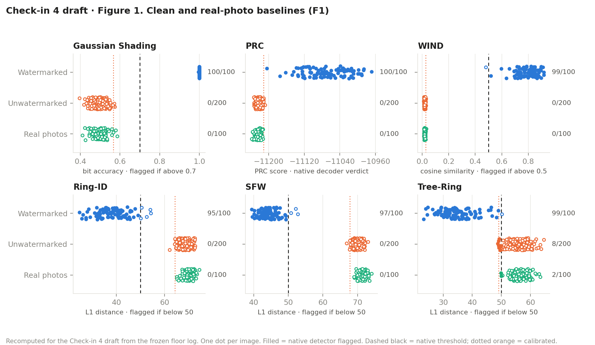
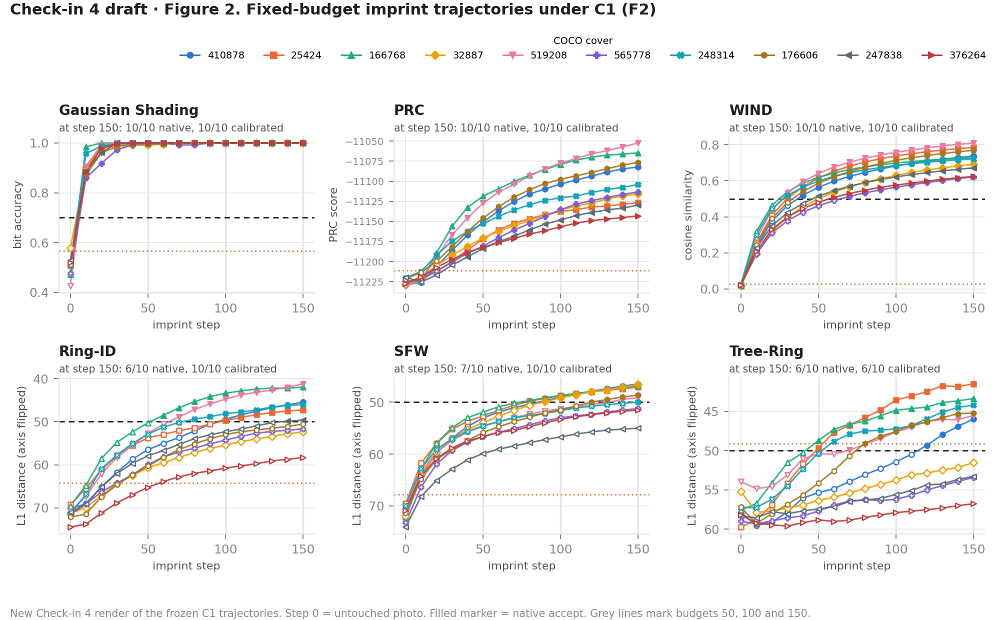
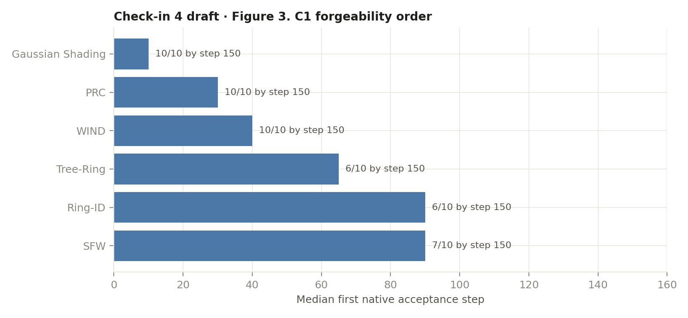
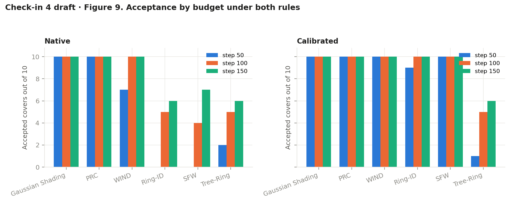
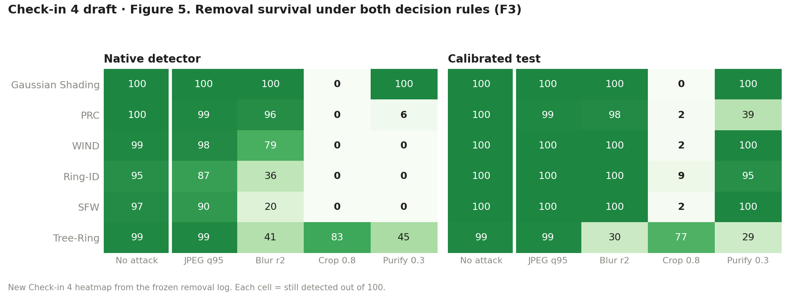
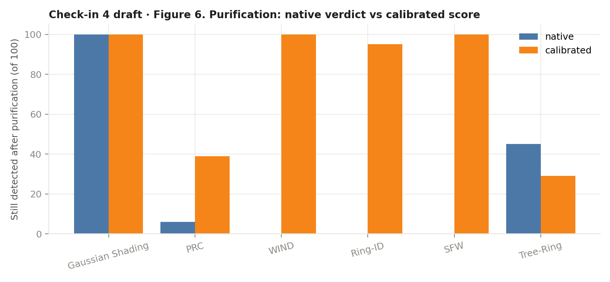
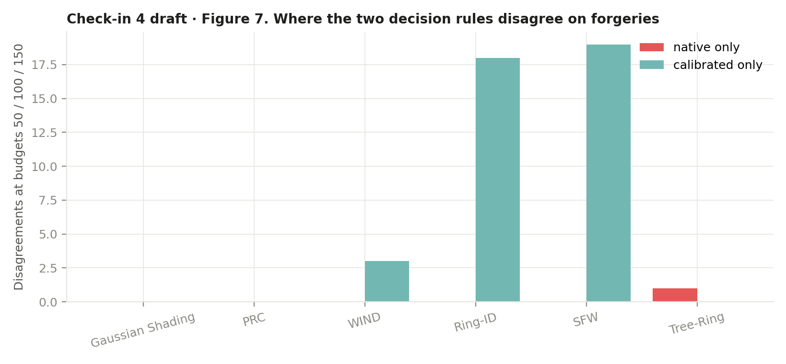
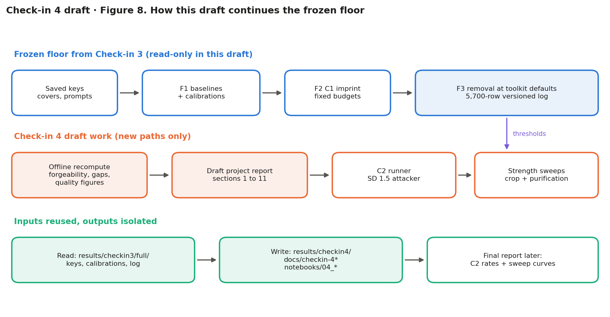

# Check-in 4

<p class="subtitle">Draft project report: Forging the Watermark: Benchmarking False Attribution in Semantic Watermarks for Diffusion Models</p>

CMPE 261 Sec 01, Fall 2026. Group 6. Team: Kanaka Sarat Siripurapu (019132776), Latha Boralingaiah (018301361), Yashashav Devalapalli Kamalraj (017856371).

Repository: <https://github.com/yashashav-dk/cmpe261-watermark-forgery>

Shared Drive folder: <https://drive.google.com/drive/folders/1wkXOxPjfI648JPod1Fi2m9ItfrPvWVIT>

The instructor (Dr. Bertin Cordova-Diba) and the TA have Editor access to the Drive folder. The repository is public, so both can open it; the instructor also has write access.

## 1. Where each requirement is met

| Requirement | Status | Where |
|---|---|---|
| Draft of the project report (required) | Done: full draft built from the floor results and the report outline | This document; source `docs/checkin-4.md` |
| Project artifacts: code and data (required) | Done as hyperlinks to GitHub, Colab notebooks and Drive | Section 10 |
| Meaningful check-ins, about 8 to 10 (required) | 10 commits since Check-in 3 | Section 11.1 and the repository history |
| Instructor and TA invited (required) | Drive: both have Editor access. GitHub: public repository, open to both; instructor also has write access | Top of this document |
| Repository and Drive link in the report (required) | Done | Top of this document |

## 2. From Check-in 3 to this draft

### 2.1 Where Check-in 3 stopped

Check-in 3 closed the floor in the specification. Nothing in that floor was re-run for this draft. The frozen package is `results/checkin3/full/` (5,700 rows in `measurements-v2.json`), with the Check-in 3 write-up in `docs/Group6_CMPE261_CheckIn_3.pdf`.

| Floor item | Done at Check-in 3 | What was saved |
|---|---|---|
| F1 baselines | 100 watermarked, 200 unwatermarked, 100 real photos per scheme; all six schemes pass inclusion | Native rates, calibrated thresholds, baseline images |
| F2 imprint under C1 | 10 covers × 6 schemes to step 150; scored at 50, 100 and 150 | Trajectories, checkpoints, PSNR / SSIM / LPIPS |
| F3 removal | JPEG, blur, crop 0.8, purification 0.3 on 100 watermarked images per scheme | Attacked images and verdicts |
| Keys and identity | One watermark key per scheme; run manifest and environment freeze | `keys/{scheme}.pkl`, calibrations, `manifest.json` |

Check-in 3 also recorded how that run itself was resumed: Colab started the work, the runtime dropped mid-forgery, and the SJSU CoE HPC cluster finished the remaining covers and all of F3 from the saved optimizer checkpoints in one 17-hour A100 job. That resume path is unchanged and is what the new C2 / sweep jobs reuse.

What Check-in 3 did **not** finish (its Section 9):

1. Imprint with Stable Diffusion 1.5 as the attacker (condition C2).
2. Strength sweeps for crop and purification.
3. Extended schemes (ROBIN, SEAL, GaussMarker), if they pass inclusion.
4. The draft of the project report (recommended then; required now).

### 2.2 How we resumed

We did not regenerate the floor. Check-in 4 starts from the Check-in 3 tree as a read-only base:

1. **Same provider.** Stable Diffusion 2.1-base at the same revision, same MarkDiffusion commit, same native thresholds.
2. **Same keys.** `results/checkin3/full/keys/{scheme}.pkl` are restored; C2 and the sweeps refuse to invent a new key.
3. **Same covers and prompts.** First ten ids in `data/coco_val2017_checkin3.txt`; prompts from `data/prompts_checkin3.txt`.
4. **Same calibrations.** Each `{scheme}-calibration.json` from Check-in 3 is copied into the C2 / sweep output and used as-is.
5. **Same measurement rules.** Fixed budgets 50 / 100 / 150, Wilson intervals, bootstrap over images with seed 261.
6. **New writes only under Check-in 4 paths.** Code, analyses and figures go to `docs/checkin-4*`, `src/wmforge/{models,sweep,checkin4,analysis}.py`, `results/checkin4/`, `notebooks/04_checkin4_colab.ipynb`. The Check-in 3 files stay frozen.

Offline tables and figures in this draft are recomputed from the frozen log by `python -m wmforge.analysis` and `scripts/checkin4_analysis.py`. No GPU was required for those.

### 2.3 What is done now (Check-in 4)

| # | Carry-over from Check-in 3 | Status in this check-in |
|---|---|---|
| 1 | C2 imprint (SD 1.5 attacker) | **Runner and protocol done.** `src/wmforge/models.py`, `src/wmforge/checkin4.py`, `docs/checkin-4-protocol.md`, notebook. GPU job scheduled on CoE HPC; rates go in the final report. |
| 2 | Crop and purification strength sweeps | **Grids and runner done.** `src/wmforge/sweep.py`. Crop ratios 0.95 to 0.60; purification strengths 0.10 to 0.50. GPU job scheduled with C2. |
| 3 | Extended schemes | Not started; still gated on the inclusion rule. |
| 4 | Draft of the project report | **Done in this document** (required for Check-in 4). |
| 5 | (extra) Read the floor for the draft | **Done.** Forgeability order, native vs calibrated disagreement, purification gap and per-cover PSNR written under `results/checkin4/`. |

In short: Check-in 3 owns the measured floor. Check-in 4 owns the draft report, the offline reading of that floor, and the software that continues into C2 and the strength sweeps without touching the frozen results.

## 3. Abstract (draft)

A semantic watermark hides a signal in the starting noise of a diffusion model and checks for it by inverting a candidate image back to that noise. Published evaluations of these schemes test almost only whether the signal survives edits. We study the opposite failure, false attribution: an attacker takes a real photograph that the provider never generated and changes it until the provider's detector says it is watermarked. Building on the MarkDiffusion toolkit and the black-box imprint attack of Mueller et al., we benchmark six semantic schemes on Stable Diffusion 2.1-base. The floor experiment uses full-size baselines (100 watermarked, 200 unwatermarked and 100 real images per scheme), forgery at fixed budgets of 50, 100 and 150 optimization steps on ten photographs, and four removal attacks on 100 watermarked images. Every result is reported at the toolkit's native threshold and at a threshold calibrated to a 1% false-positive rate. With the provider's model as the attacker, the native detectors of Gaussian Shading, PRC and WIND accepted all ten forged photographs, and those of Tree-Ring, Ring-ID and SFW six to seven; under the calibrated test Ring-ID and SFW also reached ten of ten. A centered crop removed five of the six watermarks, and diffusion purification defeated three native detectors whose calibrated scores still separated the images. Forgeability and resistance to removal do not go together across these schemes. This draft freezes the floor results, adds offline analyses of threshold disagreement and perceptual cost, and ships the runners for cross-weight forgery (Stable Diffusion 1.5) and for strength sweeps of crop and purification. All experiments are inference only, and every rate carries a confidence interval.

## 4. Introduction (draft)

Providers of text-to-image models are asked to prove provenance of their outputs. One line of work embeds a semantic watermark in the initial noise of a diffusion sampler and recovers it by DDIM inversion. That design survives many pixel edits better than older pixel-space marks, which is why most published tests focus on removal. False attribution is the other direction: an attacker who never used the provider's sampler still gets the detector to say "watermarked."

False attribution matters because a detector that fires on an ordinary photograph can be used to blame the wrong source. The imprint attack of Mueller et al. [16] shows that this is possible for Tree-Ring and Gaussian Shading when the attacker has the provider's own model. It does not say how the other schemes MarkDiffusion ships behave under the same threat, how native thresholds compare with a shared operating point, or how removal numbers sit next to forgery numbers.

This project measures false attribution for six semantic schemes on one pinned model, with fixed step budgets, two decision rules, and removal attacks run on the same watermarked set. The contributions of the draft are:

1. A common floor protocol (F1 to F3) run end to end for Tree-Ring, Ring-ID, SFW, WIND, Gaussian Shading and PRC.
2. Evidence that native thresholds can hide forgeability for Ring-ID and SFW and can hide residual signal after purification for Ring-ID, SFW and WIND.
3. A side-by-side view of forgery and removal that does not collapse into a single ranking.
4. Released runners for condition C2 (Stable Diffusion 1.5 attacker) and for strength sweeps of crop and purification.

## 5. Background and related work (draft)

**Schemes.** Semantic watermarks sit in the latent noise rather than in the pixels. Tree-Ring [1] writes a ring pattern into the Fourier transform of the initial noise and detects it by DDIM inversion [12] followed by an L1 distance to the pattern. RingID [2] redesigns the key so that many keys can be told apart. Gaussian Shading [3] maps a secret bit string to the initial noise through Gaussian quantiles and scores bit accuracy. PRC [4] replaces the bit string with a pseudorandom error-correcting code. WIND [5] combines a Fourier group index with a salted family of initial noises. ROBIN [6], SEAL [7] and GaussMarker [8] need extra pretrained assets and are held for the extended set. MarkDiffusion [9] puts the schemes behind one interface.

**Removal.** WAVES [10] ranks watermarks under distortions, regeneration and adversarial attacks. Zhao et al. [11] show that regeneration removes bounded pixel-space marks. DiffPure [13] is the purification procedure most regeneration attacks reuse. UnMarker [14] attacks spectral content. Saberi et al. [15] give limits for watermark-based detectors and include an early spoofing result.

**Forgery.** Mueller et al. [16] introduce imprint forgery and evaluate Tree-Ring and Gaussian Shading. Jain et al. [17] forge and remove latent-noise watermarks from a single image across more schemes, but not on a common model, threshold policy or step budget, and not next to removal numbers. Our floor fills that gap for six schemes.

## 6. Threat model and benchmark design (draft)

**Attacker.** The attacker has one watermarked reference image, a diffusion model that can invert and decode latents, and no access to the watermark key or the detector during optimization. Success means the provider's detector flags the edited real photograph as watermarked.

**Conditions.**

| Condition | Attacker model | Role in this draft |
|---|---|---|
| C1 | Stable Diffusion 2.1-base (provider) | Floor results in Section 7 |
| C2 | Stable Diffusion 1.5 | Runner ready; GPU numbers for the final report |
| C3 | PixArt-Σ | Stretch; not started |

**Floor protocol.**

1. **F1.** For each scheme, generate 100 watermarked and 200 unwatermarked images and score 100 real photographs. A scheme enters only if native TPR ≥ 90% and native FPR ≤ 5% on unwatermarked generations. Calibrate a second threshold on the 200 unwatermarked scores so that at most 2 of 200 pass (1%).
2. **F2.** Imprint the same ten COCO covers for 150 steps without early stopping. Report acceptance at steps 50, 100 and 150 under both rules, with PSNR, SSIM and LPIPS against the cover.
3. **F3.** Apply JPEG (quality 95), Gaussian blur (radius 2), centered crop-and-rescale (ratio 0.8) and diffusion purification (strength 0.3) to the same 100 watermarked images and re-detect.

**Statistics.** Rates use 95% Wilson intervals. Continuous metrics use 10,000-resample percentile bootstrap intervals over images, seed 261.

**Target items added in this check-in.** The C2 runner loads the pinned Stable Diffusion 1.5 weights as the attacker and reuses the Check-in 3 keys, covers and calibrations. The sweep module re-opens the watermarked baselines at crop ratios (0.95, 0.90, 0.85, 0.80, 0.70, 0.60) and purification strengths (0.10, 0.20, 0.30, 0.40, 0.50).

## 7. Experimental results (floor, draft)

Stable Diffusion 2.1-base at 512×512, 50 sampling and inversion steps, guidance 7.5, full precision, each scheme at its MarkDiffusion default. The log has 5,700 rows. All figures below are new Check-in 4 renders saved under `results/checkin4/figures/` (drawn by `scripts/checkin4_figures.py` from the frozen floor log).

### 7.1 Clean and real-photo baselines (F1)

<p class="tcap">Table 1. Native detection on the two baselines.</p>

| Scheme | Detector score | TPR, watermarked | FPR, unwatermarked | FPR, real photos | Passes inclusion rule |
|---|---|---|---|---|---|
| Gaussian Shading | bit accuracy, above 0.7 | 100/100 = 100% [96%, 100%] | 0/200 = 0% [0%, 2%] | 0/100 = 0% [0%, 4%] | yes |
| PRC | decoder verdict | 100/100 = 100% [96%, 100%] | 0/200 = 0% [0%, 2%] | 0/100 = 0% [0%, 4%] | yes |
| WIND | cosine similarity, above 0.5 | 99/100 = 99% [95%, 100%] | 0/200 = 0% [0%, 2%] | 0/100 = 0% [0%, 4%] | yes |
| Ring-ID | L1 distance, below 50 | 95/100 = 95% [89%, 98%] | 0/200 = 0% [0%, 2%] | 0/100 = 0% [0%, 4%] | yes |
| SFW | L1 distance, below 50 | 97/100 = 97% [92%, 99%] | 0/200 = 0% [0%, 2%] | 0/100 = 0% [0%, 4%] | yes |
| Tree-Ring | L1 distance, below 50 | 99/100 = 99% [95%, 100%] | 8/200 = 4% [2%, 8%] | 2/100 = 2% [1%, 7%] | yes, close to the limit |

<p class="tcap">Table 2. Calibrated thresholds and their detection rates.</p>

| Scheme | Calibrated threshold | TPR, watermarked | FPR, unwatermarked (by construction) | FPR, real photos |
|---|---|---|---|---|
| Gaussian Shading | bit accuracy above 0.566 | 100/100 | 2/200 | 2/100 = 2% [1%, 7%] |
| PRC (score-only test) | PRC score above −11211.0 | 100/100 | 2/200 | 0/100 |
| WIND | cosine similarity above 0.027 | 100/100 | 2/200 | 4/100 = 4% [2%, 10%] |
| Ring-ID | L1 distance below 64.2 | 100/100 | 2/200 | 0/100 |
| SFW | L1 distance below 67.8 | 100/100 | 2/200 | 0/100 |
| Tree-Ring | L1 distance below 49.1 | 99/100 | 2/200 | 0/100 |

<figure>

<figcaption>Figure 1. Check-in 4 draft figure. Detector scores from the two baselines (400 images per scheme). Filled: native detector flagged the image. Dashed black: native threshold. Dotted orange: calibrated threshold.</figcaption>
</figure>

All six schemes enter. Tree-Ring is the only one with a non-zero native false-positive rate on generated images (4%) and on real photographs (2%). Calibration on generated images does not carry over exactly to photographs: Gaussian Shading and WIND flag 2 and 4 of 100 real photographs under the calibrated test.

### 7.2 Fixed-budget imprint forgery under C1 (F2)

<p class="tcap">Table 3. Forged photographs accepted at each budget.</p>

| Scheme | Step 50, native | Step 50, calibrated | Step 100, native | Step 100, calibrated | Step 150, native | Step 150, calibrated | Median first acceptance (native) |
|---|---|---|---|---|---|---|---|
| Gaussian Shading | 10/10 | 10/10 | 10/10 | 10/10 | 10/10 [72%, 100%] | 10/10 | step 10 |
| PRC | 10/10 | 10/10 | 10/10 | 10/10 | 10/10 [72%, 100%] | 10/10 | step 30 (20 to 40) |
| WIND | 7/10 | 10/10 | 10/10 | 10/10 | 10/10 [72%, 100%] | 10/10 | step 40 (30 to 70) |
| Tree-Ring | 2/10 | 1/10 | 5/10 | 5/10 | 6/10 [31%, 83%] | 6/10 | step 65 (50 to 120) |
| Ring-ID | 0/10 | 9/10 | 5/10 | 10/10 | 6/10 [31%, 83%] | 10/10 | step 90 (60 to 140) |
| SFW | 0/10 | 10/10 | 4/10 | 10/10 | 7/10 [40%, 89%] | 10/10 | step 90 (80 to 150) |

<figure>

<figcaption>Figure 2. Check-in 4 draft figure. Detector score of every cover at every evaluated step under C1. Up means closer to being flagged. Filled marker: native detector accepted the image.</figcaption>
</figure>

<figure>

<figcaption>Figure 3. Check-in 4 draft figure. C1 forgeability order by median first native acceptance. Labels show how many of ten covers were accepted by step 150.</figcaption>
</figure>

<figure>

<figcaption>Figure 3b. Check-in 4 draft figure. Accepted covers at steps 50, 100 and 150 under the native and calibrated rules.</figcaption>
</figure>

**Every core scheme can be forged, but not every photograph.** At step 150 the native detectors of Gaussian Shading, PRC and WIND accepted all ten covers; Tree-Ring and Ring-ID accepted six and SFW seven. With ten covers, 10/10 still means 72% to 100% at 95% confidence and 6/10 means 31% to 83%.

**For Ring-ID and SFW, most of the apparent resistance is the native threshold.** Under the calibrated test both reach 10/10 by step 100. Their unwatermarked scores never approach the native cutoff of 50, so the calibrated cutoffs sit at 64 and 68. Tree-Ring is different: its calibrated threshold is stricter than the native one, and it stays at 6/10 under both rules.

### 7.3 Perceptual cost

Pooled across the six schemes (60 images per budget):

| Budget | Mean PSNR (dB) | Mean SSIM | Mean LPIPS |
|---|---|---|---|
| step 50 | 22.18 [21.32, 23.09] | 0.567 [0.536, 0.597] | 0.170 [0.159, 0.180] |
| step 100 | 21.10 [20.28, 21.96] | 0.513 [0.480, 0.546] | 0.222 [0.208, 0.235] |
| step 150 | 20.45 [19.65, 21.29] | 0.482 [0.448, 0.517] | 0.262 [0.246, 0.278] |

<figure>

<figcaption>Figure 4. Check-in 4 draft figure. Mean PSNR at step 150 by cover, averaged over the six schemes. Damage tracks the photograph more than the scheme.</figcaption>
</figure>

Scheme means at a fixed budget differ by less than 0.2 dB. Covers 25424, 166768 and 519208 stay near 25 dB at step 150; the other seven end between 17 and 20 dB. At 20 dB and SSIM 0.48 the edits are visible, so these forgeries are not imperceptible at the budgets tested.

### 7.4 Removal next to forgeability (F3)

<p class="tcap">Table 4. Watermarked images still detected after each attack (native / calibrated, of 100).</p>

| Scheme | JPEG, quality 95 | Gaussian blur, radius 2 | Crop 0.8 and rescale | Diffusion purification, strength 0.3 |
|---|---|---|---|---|
| Gaussian Shading | 100 / 100 | 100 / 100 | 0 / 0 | 100 / 100 |
| PRC | 99 / 99 | 96 / 98 | 0 / 2 | 6 / 39 |
| WIND | 98 / 100 | 79 / 100 | 0 / 2 | 0 / 100 |
| Tree-Ring | 99 / 99 | 41 / 30 | 83 / 77 | 45 / 29 |
| Ring-ID | 87 / 100 | 36 / 100 | 0 / 9 | 0 / 95 |
| SFW | 90 / 100 | 20 / 100 | 0 / 2 | 0 / 100 |

<figure>

<figcaption>Figure 5. Check-in 4 draft figure. Removal survival heat maps under both decision rules, with clean detection for reference.</figcaption>
</figure>

<figure>

<figcaption>Figure 6. Check-in 4 draft figure. After purification, native verdicts and calibrated scores diverge for Ring-ID, SFW and WIND.</figcaption>
</figure>

Crop-and-rescale removes five of the six watermarks under either rule. Purification defeats the native detectors of Ring-ID, SFW and WIND (0 of 100) while the calibrated tests still detect 95 to 100. Gaussian Shading survives purification, blur and JPEG and fails only on crop. Tree-Ring is the only scheme that both resisted forgery on some covers under both rules and survived crop.

**Resistance to removal and resistance to forgery do not go together.** Gaussian Shading is the easiest scheme to forge and the hardest to strip apart from crop. We report the two axes side by side and do not combine them into one ranking.

### 7.5 Threshold disagreement (offline)

<figure>

<figcaption>Figure 7. Check-in 4 draft figure. Counts of forgeries (budgets 50, 100, 150) where only one decision rule accepts the image.</figcaption>
</figure>

On imprint rows alone, Ring-ID and SFW show 18 and 19 calibrated-only accepts out of 30 budgeted images. Tree-Ring shows one native-only accept. On removal, the calibrated-only count reaches 181 for Ring-ID, 192 for SFW and 125 for WIND, almost all from blur and purification. The draft treats native and calibrated columns as separate facts, not as interchangeable summaries.

### 7.6 Limits of the floor

- Ten covers still give wide intervals for forgery.
- The calibrated threshold is fit on the same 200 unwatermarked images it is checked on.
- Each removal attack in F3 uses one toolkit default; the strength sweeps address that for crop and purification once the GPU run finishes.
- C1 is an upper bound on attacker strength. C2 numbers are not in this draft.
- Measurements span three GPU types with identical software. Trajectories are not bit-for-bit across machines.

## 8. Approach and algorithms (draft)

**Pipeline.** Three parts pass only images: a MarkDiffusion harness (generate, detect), the imprint attack adapted from [16], and a versioned measurement log that refuses to mix runs with different code, keys, inputs or environment.

<figure>

<figcaption>Figure 8. Check-in 4 draft figure. How this draft continues the frozen floor: read-only Check-in 3 inputs, new Check-in 4 outputs, C2 and sweeps pending GPU rates.</figcaption>
</figure>

**Imprint at a fixed budget.**

```
Input: cover c, watermarked reference r, attacker pipeline, budget K = 150
1. z_target = Invert(Encode(r))          # 50 DDIM steps, empty prompt, no guidance
2. z = Encode(c), trainable; Adam, lr 1e-2
3. for step in 1..K:                     # never stops early
       loss = MSE(Invert(z), z_target)
       Adam step
       every 10 steps: decode, detect, record PSNR/SSIM/LPIPS, checkpoint
4. report saved images at steps 50, 100 and 150
```

**Calibrated threshold.** Orient scores so larger means more watermarked. Sort the 200 unwatermarked scores, set the threshold to the 198th, accept when the score is strictly greater. At most two calibration images pass.

**C2 attacker.** `wmforge.models.ATTACKER_C2` pins `stable-diffusion-v1-5/stable-diffusion-v1-5` at revision `451f4fe16113bdc1c2ae000260dc525a8138637d`. `python -m wmforge.checkin4 c2-imprint` restores each Check-in 3 key, loads the SD 1.5 attacker, and writes under `results/checkin4/c2/`.

**Strength sweeps.** `python -m wmforge.checkin4 sweep` re-detects the watermarked baselines after crops and purifications on the grids above and writes under `results/checkin4/sweeps/`.

## 9. Discussion and next steps (draft)

Native thresholds are what a provider deploys, but they are not comparable across schemes and they can disagree with a shared 1% operating point on the same image. For provenance claims that must hold on real photographs, the real-photo false-positive rates in Table 2 matter as much as the forgery rates in Table 3.

The draft does not claim a winner. It claims a measurement: under C1, every core scheme in MarkDiffusion can be forged on at least six of ten photographs by step 150 at the native rule, and crop removes five of six marks at the toolkit default.

**For the final report.**

1. Finish the C2 imprint runs on the same ten covers and budgets.
2. Finish the crop and purification strength sweeps.
3. Attempt ROBIN, SEAL and GaussMarker against the inclusion rule.
4. Fold those numbers into Sections 7 and 9 and freeze the text.

## 10. Project artifacts

| Artifact | Location |
|---|---|
| Source repository | <https://github.com/yashashav-dk/cmpe261-watermark-forgery> |
| Shared Drive (keys, images, cluster copies) | <https://drive.google.com/drive/folders/1wkXOxPjfI648JPod1Fi2m9ItfrPvWVIT> |
| Specification | [`docs/project-spec.md`](project-spec.md) |
| Check-in 1 / 2 / 3 reports | [`docs/checkin-1.md`](checkin-1.md), [`docs/CMPE261_CheckIn2_Group6.pdf`](CMPE261_CheckIn2_Group6.pdf), [`docs/Group6_CMPE261_CheckIn_3.pdf`](Group6_CMPE261_CheckIn_3.pdf) |
| This draft | [`docs/checkin-4.md`](checkin-4.md) |
| Floor measurements (5,700 rows) | [`results/checkin3/full/`](../results/checkin3/full/) |
| Offline draft analyses and new figures | [`results/checkin4/analysis/`](../results/checkin4/analysis/), [`results/checkin4/figures/`](../results/checkin4/figures/) (`scripts/checkin4_figures.py`) |
| C2 and sweep runners | [`src/wmforge/checkin4.py`](../src/wmforge/checkin4.py), [`src/wmforge/sweep.py`](../src/wmforge/sweep.py), [`src/wmforge/models.py`](../src/wmforge/models.py) |
| Colab notebooks | [`notebooks/03_checkin3_colab.ipynb`](../notebooks/03_checkin3_colab.ipynb), [`notebooks/04_checkin4_colab.ipynb`](../notebooks/04_checkin4_colab.ipynb) |

Data selections are committed under `data/`. Model weights and the large image trees stay on Drive and on the CoE HPC account; the repository keeps hashes, calibrations and logs.

## 11. Check-ins and contributions

### 11.1 Commits since Check-in 3

| Date | Member | Commit |
|---|---|---|
| 2026-11-15 | Kanaka Sarat | docs(checkin4): spell out Check-in 3 freeze, resume path, and current work |
| 2026-11-15 | Yashashav | docs(checkin4): update README and point to the draft report |
| 2026-11-14 | Latha | feat(pdf): render the Check-in 4 draft report |
| 2026-11-13 | Kanaka Sarat | docs: draft the full project report from the floor results |
| 2026-11-12 | Yashashav | feat(colab): add the Check-in 4 notebook for C2 and sweeps |
| 2026-11-10 | Latha | feat(report): offline C1 tables, disagreement and quality figures |
| 2026-11-08 | Kanaka Sarat | feat(analysis): recompute forgeability and threshold gaps from the log |
| 2026-11-06 | Yashashav | feat(checkin4): run imprint under C2 with frozen Check-in 3 keys |
| 2026-11-04 | Latha | feat(sweep): parameterize crop and purification strengths |
| 2026-11-03 | Kanaka Sarat | feat(models): register pinned C1 and C2 attacker pipelines |

<p class="note">Ten commits since Check-in 3. Running totals will be updated on the final report once the GPU jobs land.</p>

### 11.2 What each member did since Check-in 3

The team agrees that the three members contributed equally.

**Kanaka Sarat Siripurapu (models, analysis, draft text).** Pinned C1/C2 model registry; offline analysis of the 5,700-row log; draft report sections that freeze the floor numbers.

**Latha Boralingaiah (sweeps, figures, PDF).** Parameterized crop and purification sweeps; analysis summary and figures; PDF renderer for this draft.

**Yashashav Devalapalli Kamalraj (C2 runner, notebook, README).** C2 imprint runner that restores Check-in 3 keys; Colab notebook; README and artifact index. Cluster jobs for C2 and sweeps run on his CoE HPC account.

## References

[1] Y. Wen, J. Kirchenbauer, J. Geiping, T. Goldstein. Tree-Ring Watermarks: Fingerprints for Diffusion Images that are Invisible and Robust. NeurIPS 2023. arXiv:2305.20030.

[2] H. Ci, P. Yang, Y. Song, M. Z. Shou. RingID: Rethinking Tree-Ring Watermarking for Enhanced Multi-Key Identification. ECCV 2024. arXiv:2404.14055.

[3] Z. Yang et al. Gaussian Shading: Provable Performance-Lossless Image Watermarking for Diffusion Models. CVPR 2024. arXiv:2404.04956.

[4] S. Gunn, X. Zhao, D. Song. An Undetectable Watermark for Generative Image Models. 2024. arXiv:2410.07369.

[5] K. Arabi, B. Feuer, R. T. Witter, C. Hegde, N. Cohen. Hidden in the Noise: Two-Stage Robust Watermarking for Images. 2024. arXiv:2412.04653.

[6] H. Huang, Y. Wu, Q. Wang. ROBIN: Robust and Invisible Watermarks for Diffusion Models with Adversarial Optimization. NeurIPS 2024. arXiv:2411.03862.

[7] K. Arabi, R. T. Witter, C. Hegde, N. Cohen. SEAL: Semantic Aware Image Watermarking. 2025. arXiv:2503.12172.

[8] K. Li et al. GaussMarker: Robust Dual-Domain Watermark for Diffusion Models. ICML 2025. arXiv:2506.11444.

[9] L. Pan et al. MarkDiffusion: An Open-Source Toolkit for Generative Watermarking of Latent Diffusion Models. 2025. arXiv:2509.10569.

[10] B. An et al. WAVES: Benchmarking the Robustness of Image Watermarks. ICML 2024.

[11] X. Zhao et al. Invisible Image Watermarks Are Provably Removable Using Generative AI. NeurIPS 2024. arXiv:2306.01953.

[12] J. Song, C. Meng, S. Ermon. Denoising Diffusion Implicit Models. ICLR 2021. arXiv:2010.02502.

[13] W. Nie et al. Diffusion Models for Adversarial Purification. ICML 2022. arXiv:2205.07460.

[14] A. Kassis, U. Hengartner. UnMarker: A Universal Attack on Defensive Image Watermarking. IEEE S&P 2025. arXiv:2405.08363.

[15] M. Saberi et al. Robustness of AI-Image Detectors: Fundamental Limits and Practical Attacks. ICLR 2024. arXiv:2310.00076.

[16] A. Mueller, D. Lukovnikov, J. Thietke, A. Fischer, E. Quiring. Black-Box Forgery Attacks on Semantic Watermarks for Diffusion Models. CVPR 2025. arXiv:2412.03283.

[17] A. Jain, Y. Kobayashi, N. Murata, Y. Takida, T. Shibuya, Y. Mitsufuji, N. Cohen, N. Memon, J. Togelius. Forging and Removing Latent-Noise Diffusion Watermarks Using a Single Image. 2025. arXiv:2504.20111.
