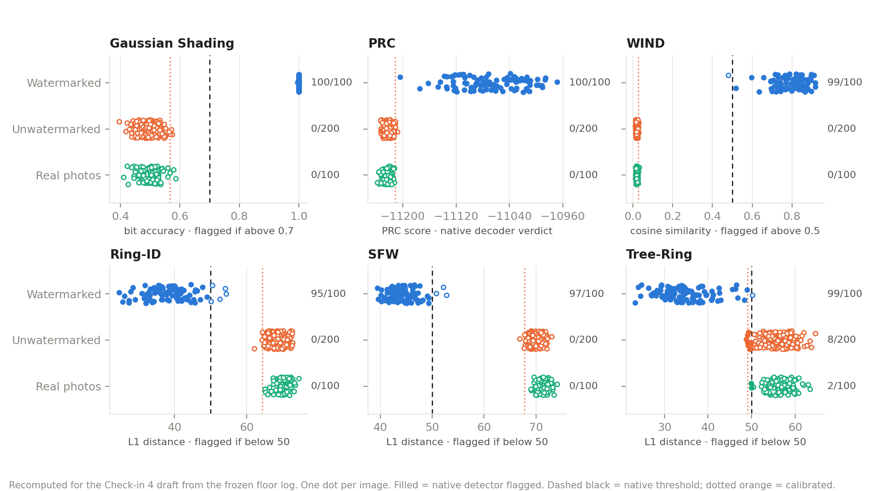
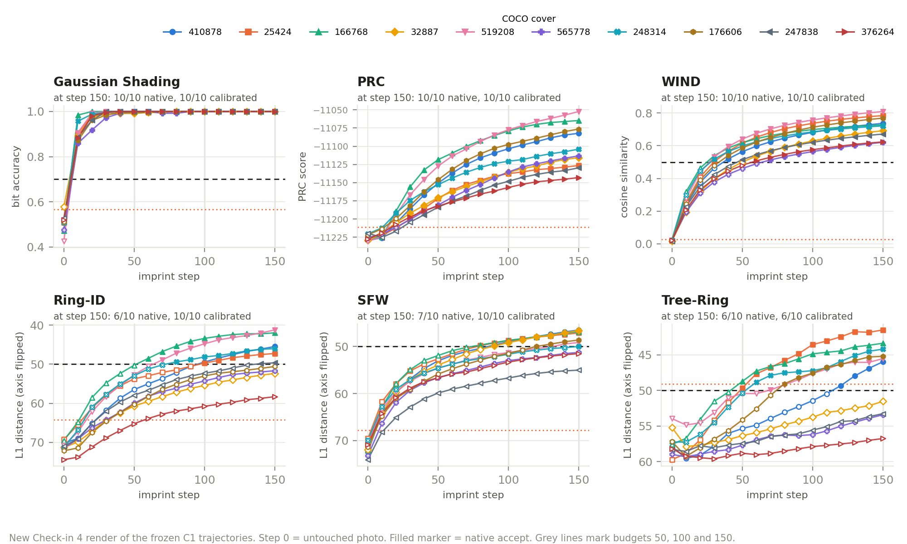
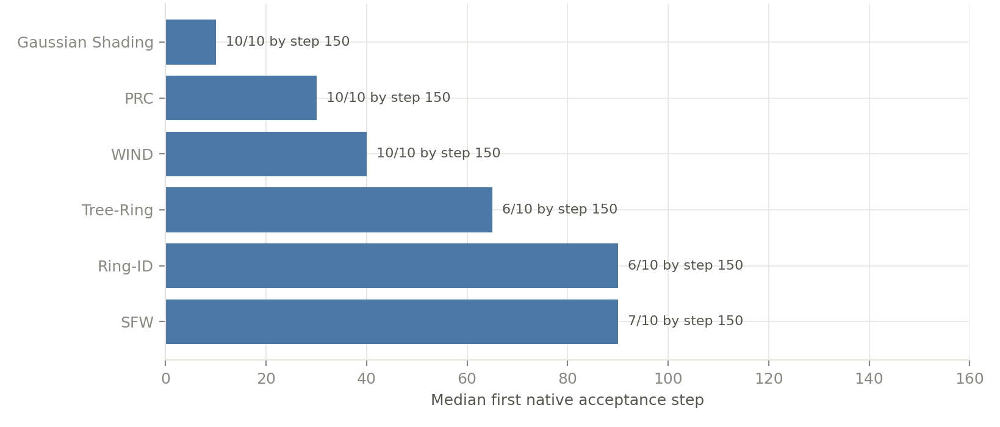
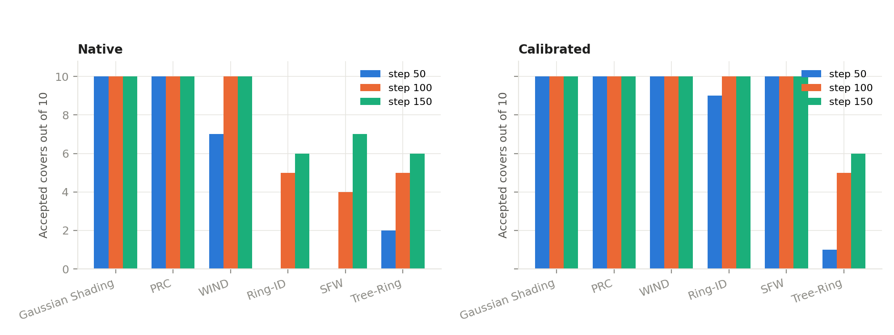
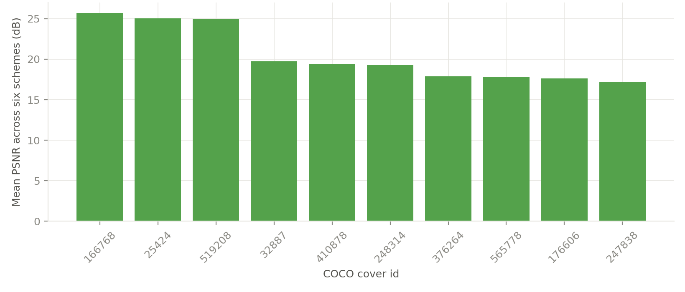
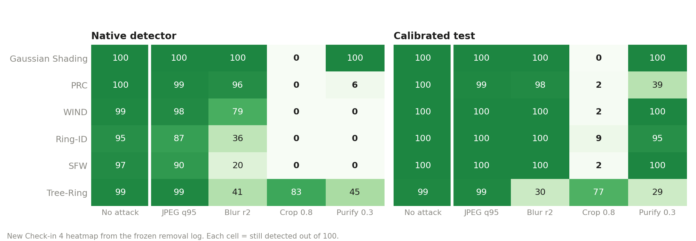
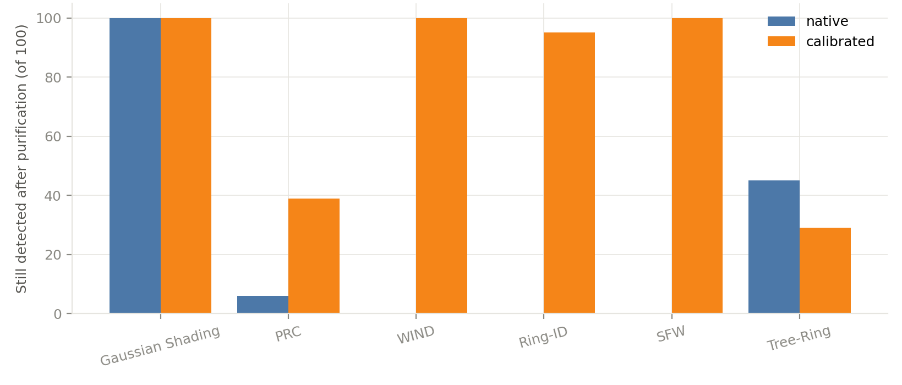
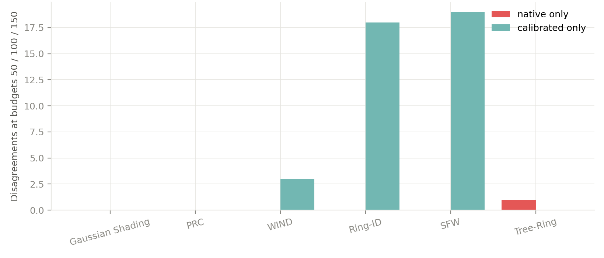
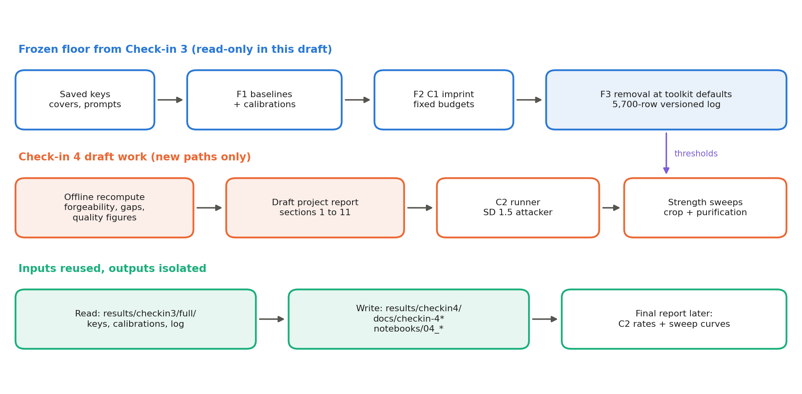

# Check-in 4

<p class="subtitle">Draft project report: Forging the Watermark: Benchmarking False Attribution in Semantic Watermarks for Diffusion Models</p>

CMPE 261 Sec 01, Fall 2026. Group 6. Kanaka Sarat Siripurapu (019132776, kanakasarat.siripurapu@sjsu.edu), Latha Boralingaiah (018301361, latha.boralingaiah@sjsu.edu), Yashashav Devalapalli Kamalraj (017856371, yashashav.devalapallikamalraj@sjsu.edu). Department of Computer Engineering, San José State University.

Repository (Check-in 4 branch): <https://github.com/yashashav-dk/cmpe261-watermark-forgery/tree/checkin4-results>

Shared Drive folder: <https://drive.google.com/drive/folders/1wkXOxPjfI648JPod1Fi2m9ItfrPvWVIT>

The instructor (Dr. Bertin Cordova-Diba) and the TA have Editor access to the Drive folder. The repository is public, so both can open it; the instructor also has write access.

## 1. Where each requirement is met

| Requirement | Status | Where |
|---|---|---|
| Draft of the project report (required) | Done: abstract, introduction, related work, threat model, results, approach and discussion | Sections 3 to 9 |
| Project artifacts: code and data (required) | Done as hyperlinks to GitHub, Colab and Drive | Section 10 |
| Meaningful check-ins, about 8 to 10 (required) | 24 commits since Check-in 3 | Section 11.1 |
| Instructor and TA invited (required) | Drive Editor access; public GitHub; instructor has write access | Top of this document |
| Repository and Drive link in the report (required) | Done | Top of this document |

## 2. From Check-in 3 to this draft

Check-in 3 froze the floor: full-size baselines, C1 imprint to step 150, and four removal attacks for all six schemes (5,700 rows in [`results/checkin3/full/`](https://github.com/yashashav-dk/cmpe261-watermark-forgery/tree/checkin4-results/results/checkin3/full)), after Colab dropped mid-forgery and the CoE HPC cluster finished the rest from saved checkpoints. That package, including keys and calibrations, is read-only for this check-in. Nothing in it was re-run; every number in this draft is read from that log.

| # | Carry-over from Check-in 3 | Status in this check-in |
|---|---|---|
| 1 | C2 imprint (Stable Diffusion 1.5 attacker) | Runner and protocol done (`src/wmforge/models.py`, `src/wmforge/checkin4.py`, `docs/checkin-4-protocol.md`). GPU runs are being set up on the CoE HPC cluster; no C2 numbers are in this draft. |
| 2 | Crop and purification strength sweeps | Grids and runner done (`src/wmforge/sweep.py`): crop ratios 0.95 to 0.60, purification strengths 0.10 to 0.50. Run together with C2; no sweep numbers are in this draft. |
| 3 | Extended schemes (ROBIN, SEAL, GaussMarker) | Not started; still gated on the inclusion rule. |
| 4 | Draft of the project report | Done in this document. |
| 5 | Offline reading of the floor | Done: forgeability order, native vs calibrated disagreement, purification gap and per-cover image quality, written to `results/checkin4/`. |

## 3. Abstract (draft)

A semantic watermark hides a signal in the starting noise of a diffusion model and checks for it by inverting a candidate image back to that noise. Published evaluations of these schemes test almost only whether the signal survives edits. We study the opposite failure, false attribution: an attacker takes a real photograph that the provider never generated and changes it until the provider's detector says it is watermarked. Building on the MarkDiffusion toolkit [9] and the black-box imprint attack of Müller et al. [16], we benchmark six semantic schemes on Stable Diffusion 2.1-base. The floor experiment uses full-size baselines (100 watermarked, 200 unwatermarked and 100 real images per scheme), forgery at fixed budgets of 50, 100 and 150 optimization steps on ten photographs, and four removal attacks on 100 watermarked images. Every result is reported at the toolkit's native threshold and at a threshold calibrated to a 1% false-positive rate. With the provider's model as the attacker, the native detectors of Gaussian Shading, PRC and WIND accepted all ten forged photographs, and those of Tree-Ring, Ring-ID and SFW six to seven; under the calibrated test Ring-ID and SFW also reached ten of ten. A centered crop removed five of the six watermarks, and diffusion purification defeated three native detectors whose calibrated scores still separated the images. Forgeability and resistance to removal do not go together across these schemes. Rates are reported with 95% Wilson intervals. Runners for cross-model forgery (Stable Diffusion 1.5 as the attacker) and for crop and purification strength sweeps are complete; their results will be added in the final report.

## 4. Introduction (draft)

Providers of text-to-image models are asked to prove the provenance of their outputs. One line of work embeds a semantic watermark in the initial noise of a diffusion sampler and recovers it by DDIM inversion [12]. That design survives many pixel edits better than older pixel-space marks, which is why most published tests focus on removal. False attribution is the other direction: an attacker who never used the provider's sampler still gets the detector to say "watermarked."

False attribution matters because a detector that fires on an ordinary photograph can be used to blame the wrong source. The imprint attack of Müller et al. [16] shows that this is possible for Tree-Ring and Gaussian Shading when the attacker has the provider's own model. It does not say how the other schemes MarkDiffusion ships behave under the same threat, how native thresholds compare with a shared operating point, or how removal numbers sit next to forgery numbers.

This project measures false attribution for six semantic schemes on one pinned model, with fixed step budgets, two decision rules, and removal attacks run on the same watermarked set. The contributions of the draft are:

1. A common floor protocol (F1 to F3) run end to end for Tree-Ring, Ring-ID, SFW, WIND, Gaussian Shading and PRC.
2. Evidence that native thresholds can hide forgeability for Ring-ID and SFW and can hide residual signal after purification for Ring-ID, SFW and WIND.
3. A side-by-side view of forgery and removal that does not collapse into a single ranking.
4. Runners for condition C2 (Stable Diffusion 1.5 attacker) and for strength sweeps of crop and purification.

## 5. Background and related work (draft)

**Schemes.** Semantic watermarks sit in the latent noise rather than in the pixels. Tree-Ring [1] writes a ring pattern into the Fourier transform of the initial noise and detects it by DDIM inversion [12] followed by an L1 distance to the pattern. RingID [2] redesigns the key so that many keys can be told apart. SFW [18] revisits Fourier-domain semantic watermarking to improve robustness and generation quality. Gaussian Shading [3] maps a secret bit string to the initial noise through Gaussian quantiles and scores bit accuracy. PRC [4] replaces the bit string with a pseudorandom error-correcting code. WIND [5] combines a Fourier group index with a salted family of initial noises. ROBIN [6], SEAL [7] and GaussMarker [8] need extra pretrained assets and are held for the extended set. MarkDiffusion [9] puts the schemes behind one interface.

**Removal.** WAVES [10] ranks watermarks under distortions, regeneration and adversarial attacks. Zhao et al. [11] show that regeneration removes bounded pixel-space marks. DiffPure [13] is the purification procedure most regeneration attacks reuse. UnMarker [14] attacks spectral content. Saberi et al. [15] give limits for watermark-based detectors and include an early spoofing result.

**Forgery.** Müller et al. [16] introduce imprint forgery and evaluate Tree-Ring and Gaussian Shading. Jain et al. [17] forge and remove latent-noise watermarks from a single image across more schemes, but not on a common model, threshold policy or step budget, and not next to removal numbers. Our floor fills that gap for six schemes.

## 6. Threat model and benchmark design (draft)

**Attacker.** The attacker has one watermarked reference image, a diffusion model that can invert and decode latents, and no access to the watermark key or the detector during optimization. Success means the provider's detector flags the edited real photograph as watermarked.

**Conditions.**

| Condition | Attacker model | Role in this draft |
|---|---|---|
| C1 | Stable Diffusion 2.1-base (the provider's own model) | Floor results in Section 7 |
| C2 | Stable Diffusion 1.5 (a different model) | Runner ready; results for the final report |
| C3 | PixArt-Σ (a different architecture) | Stretch; not started |

**Floor protocol.**

1. **F1, baselines.** For each scheme, generate 100 watermarked and 200 unwatermarked images and score 100 real photographs. A scheme enters only if native TPR ≥ 90% and native FPR ≤ 5% on unwatermarked generations (the inclusion rule).
2. **F2, imprint forgery.** Imprint the same ten COCO covers for 150 steps without early stopping. Report acceptance at steps 50, 100 and 150 under both rules, with PSNR, SSIM and LPIPS against the cover.
3. **F3, removal.** Apply JPEG (quality 95), Gaussian blur (radius 2), centered crop-and-rescale (ratio 0.8) and diffusion purification (strength 0.3) to the same 100 watermarked images and re-detect.

**Two decision rules.** The *native* rule is the threshold each scheme ships with in MarkDiffusion. The *calibrated* rule uses one shared operating point for every scheme: scores are oriented so that larger means "more watermarked", the 200 unwatermarked scores are sorted, and the threshold is set to the 198th, so that at most 2 of the 200 unwatermarked images (1%) pass. Because this threshold is fit on the same 200 images it is checked on, it is an empirical operating point, not an independent estimate of the population false-positive rate.

**Statistics.** Rates use 95% Wilson intervals. Continuous metrics use 10,000-resample percentile bootstrap intervals over images, seed 261.

## 7. Experimental results (floor, draft)

Stable Diffusion 2.1-base at 512×512, 50 sampling and inversion steps, guidance 7.5, full precision, each scheme at its MarkDiffusion default. The log has 5,700 rows.

### 7.1 Clean and real-photo baselines (F1)

<p class="tcap">Table 1. Native detection on the two baselines, with 95% Wilson intervals.</p>

| Scheme | Detector score | TPR, watermarked | FPR, unwatermarked | FPR, real photos | Passes inclusion rule |
|---|---|---|---|---|---|
| Gaussian Shading | bit accuracy, above 0.7 | 100/100 = 100% [96%, 100%] | 0/200 = 0% [0%, 2%] | 0/100 = 0% [0%, 4%] | yes |
| PRC | decoder verdict | 100/100 = 100% [96%, 100%] | 0/200 = 0% [0%, 2%] | 0/100 = 0% [0%, 4%] | yes |
| WIND | cosine similarity, above 0.5 | 99/100 = 99% [95%, 100%] | 0/200 = 0% [0%, 2%] | 0/100 = 0% [0%, 4%] | yes |
| Ring-ID | L1 distance, below 50 | 95/100 = 95% [89%, 98%] | 0/200 = 0% [0%, 2%] | 0/100 = 0% [0%, 4%] | yes |
| SFW | L1 distance, below 50 | 97/100 = 97% [92%, 99%] | 0/200 = 0% [0%, 2%] | 0/100 = 0% [0%, 4%] | yes |
| Tree-Ring | L1 distance, below 50 | 99/100 = 99% [95%, 100%] | 8/200 = 4% [2%, 8%] | 2/100 = 2% [1%, 7%] | yes, close to the limit |

<p class="tcap">Table 2. Calibrated thresholds and their detection rates.</p>

| Scheme | Calibrated threshold | TPR, watermarked | FPR, unwatermarked (by construction) | FPR, real photos |
|---|---|---|---|---|
| Gaussian Shading | bit accuracy above 0.566 | 100/100 | 2/200 | 2/100 = 2% [1%, 7%] |
| PRC (score-only test) | PRC score above −11211.0 | 100/100 | 2/200 | 0/100 |
| WIND | cosine similarity above 0.027 | 100/100 | 2/200 | 4/100 = 4% [2%, 10%] |
| Ring-ID | L1 distance below 64.2 | 100/100 | 2/200 | 0/100 |
| SFW | L1 distance below 67.8 | 100/100 | 2/200 | 0/100 |
| Tree-Ring | L1 distance below 49.1 | 99/100 | 2/200 | 0/100 |

<figure>

<figcaption>Figure 1. Detector scores from the two baselines (400 images per scheme). Filled: native detector flagged the image. Dashed black: native threshold. Dotted orange: calibrated threshold.</figcaption>
</figure>

All six schemes enter. Tree-Ring is the only one with a non-zero native false-positive rate on generated images (4%) and on real photographs (2%): it flags 2 of 100 real photographs with no attack at all. Calibration on generated images does not carry over exactly to photographs: Gaussian Shading and WIND flag 2 and 4 of 100 real photographs under the calibrated test.

### 7.2 Fixed-budget imprint forgery under C1 (F2)

<p class="tcap">Table 3. Forged photographs accepted at each budget (of 10 covers).</p>

| Scheme | Step 50, native | Step 50, calibrated | Step 100, native | Step 100, calibrated | Step 150, native | Step 150, calibrated | Median first native acceptance, accepted covers only | Same median, never-accepted covers counted as >150 |
|---|---|---|---|---|---|---|---|---|
| Gaussian Shading | 10/10 | 10/10 | 10/10 | 10/10 | 10/10 [72%, 100%] | 10/10 | step 10 | step 10 |
| PRC | 10/10 | 10/10 | 10/10 | 10/10 | 10/10 [72%, 100%] | 10/10 | step 30 (20 to 40) | step 30 |
| WIND | 7/10 | 10/10 | 10/10 | 10/10 | 10/10 [72%, 100%] | 10/10 | step 40 (30 to 70) | step 40 |
| Tree-Ring | 2/10 | 1/10 | 5/10 | 5/10 | 6/10 [31%, 83%] | 6/10 | step 65 (50 to 120) | step 100 |
| Ring-ID | 0/10 | 9/10 | 5/10 | 10/10 | 6/10 [31%, 83%] | 10/10 | step 90 (60 to 140) | step 120 |
| SFW | 0/10 | 10/10 | 4/10 | 10/10 | 7/10 [40%, 89%] | 10/10 | step 90 (80 to 150) | step 130 |

<p class="note">Detection is scored every 10 steps, so step 10 is the earliest value a median can take; Gaussian Shading may be forgeable even sooner. The two median columns differ only for schemes with covers that were never accepted by step 150; the second column is the fairer ranking.</p>

<figure>

<figcaption>Figure 2. Detector score of every cover at every evaluated step under C1. Up means closer to being flagged. Filled marker: native detector accepted the image.</figcaption>
</figure>

<figure>

<figcaption>Figure 3. C1 forgeability order by median first native acceptance over accepted covers only (see Table 3 for the median that counts never-accepted covers). Labels show how many of ten covers were accepted by step 150.</figcaption>
</figure>

<figure>

<figcaption>Figure 4. Accepted covers at steps 50, 100 and 150 under the native and calibrated rules.</figcaption>
</figure>

**Every core scheme can be forged, but not every photograph.** At step 150 the native detectors of Gaussian Shading, PRC and WIND accepted all ten covers; Tree-Ring and Ring-ID accepted six and SFW seven. With ten covers, 10/10 still means 72% to 100% at 95% confidence and 6/10 means 31% to 83%.

**For Ring-ID and SFW, most of the apparent resistance is the native threshold.** Under the calibrated test both reach 10/10 by step 100. Their unwatermarked scores never approach the native cutoff of 50, so the calibrated cutoffs sit at 64 and 68. Tree-Ring is different: its calibrated threshold is stricter than the native one, and it stays at 6/10 under both rules.

### 7.3 Perceptual cost

<p class="tcap">Table 4. Image quality of the forged photographs against the original cover, pooled across the six schemes (60 images per budget), with 95% bootstrap intervals.</p>

| Budget | Mean PSNR (dB) | Mean SSIM | Mean LPIPS |
|---|---|---|---|
| step 50 | 22.18 [21.32, 23.09] | 0.567 [0.536, 0.597] | 0.170 [0.159, 0.180] |
| step 100 | 21.10 [20.28, 21.96] | 0.513 [0.480, 0.546] | 0.222 [0.208, 0.235] |
| step 150 | 20.45 [19.65, 21.29] | 0.482 [0.448, 0.517] | 0.262 [0.246, 0.278] |

<figure>

<figcaption>Figure 5. Mean PSNR at step 150 by cover, averaged over the six schemes. Damage tracks the photograph more than the scheme.</figcaption>
</figure>

Scheme means at a fixed budget differ by less than 0.2 dB. Covers 166768, 25424 and 519208 stay near 25 dB at step 150 (24.9 to 25.7 dB); the other seven end between 17.1 and 19.7 dB. At about 20 dB and SSIM 0.48 the edits are visible, so these forgeries are not imperceptible at the budgets tested.

### 7.4 Removal next to forgeability (F3)

<p class="tcap">Table 5. Watermarked images still detected after each attack (native / calibrated, of 100).</p>

| Scheme | JPEG, quality 95 | Gaussian blur, radius 2 | Crop 0.8 and rescale | Diffusion purification, strength 0.3 |
|---|---|---|---|---|
| Gaussian Shading | 100 / 100 | 100 / 100 | 0 / 0 | 100 / 100 |
| PRC | 99 / 99 | 96 / 98 | 0 / 2 | 6 / 39 |
| WIND | 98 / 100 | 79 / 100 | 0 / 2 | 0 / 100 |
| Tree-Ring | 99 / 99 | 41 / 30 | 83 / 77 | 45 / 29 |
| Ring-ID | 87 / 100 | 36 / 100 | 0 / 9 | 0 / 95 |
| SFW | 90 / 100 | 20 / 100 | 0 / 2 | 0 / 100 |

<figure>

<figcaption>Figure 6. Removal survival heat maps under both decision rules, with clean detection for reference.</figcaption>
</figure>

<figure>

<figcaption>Figure 7. After purification, native verdicts and calibrated scores diverge for Ring-ID, SFW and WIND.</figcaption>
</figure>

Crop-and-rescale removes five of the six watermarks under either rule. Purification defeats the native detectors of Ring-ID, SFW and WIND (0 of 100) while the calibrated tests still detect 95 to 100. Gaussian Shading survives purification, blur and JPEG and fails only on crop. Tree-Ring is the only scheme that both resisted forgery on some covers under both rules and survived crop.

**Resistance to removal and resistance to forgery do not go together.** Gaussian Shading is the easiest scheme to forge and the hardest to strip apart from crop. We report the two axes side by side and do not combine them into one ranking.

### 7.5 Threshold disagreement

<figure>

<figcaption>Figure 8. Counts of forgeries (budgets 50, 100 and 150; 30 images per scheme) where only one decision rule accepts the image.</figcaption>
</figure>

On imprint rows alone, Ring-ID and SFW show 18 and 19 calibrated-only accepts out of 30 budgeted images, WIND shows 3, and Tree-Ring shows one native-only accept. On removal, the calibrated-only count reaches 181 for Ring-ID, 192 for SFW and 125 for WIND (of 400 attacked images each), almost all from blur and purification. The draft treats native and calibrated columns as separate facts, not as interchangeable summaries.

### 7.6 Limits of the floor

- Ten covers still give wide intervals for forgery.
- The calibrated threshold is fit on the same 200 unwatermarked images it is checked on.
- Each removal attack in F3 uses one toolkit default; the strength sweeps address that for crop and purification.
- C1 is an upper bound on attacker strength. C2 numbers are not in this draft.
- Measurements span three GPU types with identical software. Trajectories are not bit-for-bit identical across machines.

## 8. Approach and algorithms (draft)

**Pipeline.** Three parts pass only images: a MarkDiffusion harness (generate, detect), the imprint attack adapted from [16], and a versioned measurement log that refuses to mix runs with different code, keys, inputs or environment.

<figure>

<figcaption>Figure 9. How this draft continues the frozen floor: read-only Check-in 3 inputs, new Check-in 4 outputs, C2 and sweeps pending GPU runs.</figcaption>
</figure>

**Imprint at a fixed budget.** The attacker inverts the watermarked reference r to a target latent, then optimizes the latent of the cover c so that its inversion matches that target:

```
Input: cover c, watermarked reference r, attacker pipeline, budget K = 150
1. z_target = Invert(Encode(r))          # 50 DDIM steps, empty prompt, no guidance
2. z = Encode(c), trainable; Adam, learning rate 1e-2
3. for step in 1..K:                     # never stops early
       loss = MSE(Invert(z), z_target)
       Adam step
       every 10 steps: decode, detect, record PSNR/SSIM/LPIPS, checkpoint
4. report saved images at steps 50, 100 and 150
```

**Calibrated threshold.** Orient scores so larger means more watermarked. Sort the 200 unwatermarked scores s(1) ≤ … ≤ s(200), set τ_cal = s(198), and accept when the score is strictly greater than τ_cal. At most two calibration images (1%) pass.

**C2 attacker.** `wmforge.models` pins `stable-diffusion-v1-5/stable-diffusion-v1-5` at revision `451f4fe16113bdc1c2ae000260dc525a8138637d`. `python -m wmforge.checkin4 c2-imprint` restores each Check-in 3 key, loads the Stable Diffusion 1.5 attacker, keeps detection on the provider's model, and writes under `results/checkin4/c2/`.

**Strength sweeps.** `python -m wmforge.checkin4 sweep` re-detects the watermarked baselines after crops (kept side 0.95, 0.90, 0.85, 0.80, 0.70, 0.60) and purifications (strength 0.10 to 0.50) and writes under `results/checkin4/sweeps/`.

## 9. Discussion and next steps (draft)

Native thresholds are what a provider deploys, but they are not comparable across schemes and they can disagree with a shared 1% operating point on the same image. For provenance claims that must hold on real photographs, the real-photo false-positive rates in Table 2 matter as much as the forgery rates in Table 3.

The draft does not claim a winner. It claims a measurement: under C1, every core scheme in MarkDiffusion can be forged on at least six of ten photographs by step 150 at the native rule, and crop removes five of six marks at the toolkit default.

**For the final report.**

1. Finish the C2 imprint runs on the same ten covers and budgets, and report them next to C1.
2. Finish the crop and purification strength sweeps and plot survival against strength.
3. Attempt ROBIN, SEAL and GaussMarker against the inclusion rule.
4. Fold those numbers into Sections 7 and 9 and convert the draft to the two-column IEEE format.

## 10. Project artifacts

All links point to the Check-in 4 branch `checkin4-results`.

| Artifact | Location |
|---|---|
| Source repository | <https://github.com/yashashav-dk/cmpe261-watermark-forgery/tree/checkin4-results> |
| Shared Drive (keys, images, cluster copies) | <https://drive.google.com/drive/folders/1wkXOxPjfI648JPod1Fi2m9ItfrPvWVIT> |
| Specification | [`docs/project-spec.md`](https://github.com/yashashav-dk/cmpe261-watermark-forgery/blob/checkin4-results/docs/project-spec.md) |
| Check-in 3 report | [`docs/Group6_CMPE261_CheckIn_3.pdf`](https://github.com/yashashav-dk/cmpe261-watermark-forgery/blob/checkin4-results/docs/Group6_CMPE261_CheckIn_3.pdf) |
| This draft (PDF and source) | [`docs/Group6_CMPE261_CheckIn_4.pdf`](https://github.com/yashashav-dk/cmpe261-watermark-forgery/blob/checkin4-results/docs/Group6_CMPE261_CheckIn_4.pdf), [`docs/checkin-4.md`](https://github.com/yashashav-dk/cmpe261-watermark-forgery/blob/checkin4-results/docs/checkin-4.md) |
| C2 and sweep protocol | [`docs/checkin-4-protocol.md`](https://github.com/yashashav-dk/cmpe261-watermark-forgery/blob/checkin4-results/docs/checkin-4-protocol.md) |
| Floor measurements (5,700 rows) | [`results/checkin3/full/`](https://github.com/yashashav-dk/cmpe261-watermark-forgery/tree/checkin4-results/results/checkin3/full) |
| Offline analyses and figures | [`results/checkin4/analysis/`](https://github.com/yashashav-dk/cmpe261-watermark-forgery/tree/checkin4-results/results/checkin4/analysis), [`results/checkin4/figures/`](https://github.com/yashashav-dk/cmpe261-watermark-forgery/tree/checkin4-results/results/checkin4/figures) |
| C2 and sweep runners | [`src/wmforge/checkin4.py`](https://github.com/yashashav-dk/cmpe261-watermark-forgery/blob/checkin4-results/src/wmforge/checkin4.py), [`src/wmforge/sweep.py`](https://github.com/yashashav-dk/cmpe261-watermark-forgery/blob/checkin4-results/src/wmforge/sweep.py), [`src/wmforge/models.py`](https://github.com/yashashav-dk/cmpe261-watermark-forgery/blob/checkin4-results/src/wmforge/models.py) |
| Colab notebook (open in Colab) | [`notebooks/04_checkin4_colab.ipynb`](https://colab.research.google.com/github/yashashav-dk/cmpe261-watermark-forgery/blob/checkin4-results/notebooks/04_checkin4_colab.ipynb) |

Data selections are committed under `data/`. Model weights and the large image trees stay on Drive and on the CoE HPC account; the repository keeps hashes, calibrations and logs.

## 11. Commits and contributions since Check-in 3

### 11.1 Commits for Check-in 4

Check-in 4 work on `main` is split evenly across the three members (**8 commits each**, 24 total). Authors below match the public GitHub history.

| Date | Member | Commit |
|---|---|---|
| 2026-11-15 | Yashashav | fix(colab): install before torch import and restart kernel |
| 2026-11-15 | Latha | fix(colab): reinstall matched torch/torchvision after attack deps |
| 2026-11-15 | Kanaka Sarat | fix: make Colab Drive optional so analysis runs without OAuth stall |
| 2026-11-15 | Yashashav | fix: Check-in 4 runners for CPU/MPS and restore Colab install |
| 2026-11-15 | Latha | docs(checkin4): include all nine Check-in 4 figures in the draft |
| 2026-11-15 | Kanaka Sarat | feat(colab): full Check-in 4 C2 and sweep GPU runner notebook |
| 2026-11-15 | Yashashav | docs(checkin4): set commit count to 17 for CI4-only draft |
| 2026-11-15 | Latha | docs(checkin4): restore PDF and align commit log with CI4-only draft |
| 2026-11-15 | Kanaka Sarat | docs(checkin4): refresh commit count after rewrite |
| 2026-11-15 | Yashashav | docs(checkin4): keep only two CI3 paragraphs; center report on new work |
| 2026-11-15 | Latha | feat(checkin4): redraw draft figures as a new Check-in 4 set |
| 2026-11-15 | Kanaka Sarat | docs(checkin4): sync final regenerated draft PDF |
| 2026-11-15 | Yashashav | docs(checkin4): name the instructor as Dr. Bertin Cordova-Diba |
| 2026-11-15 | Latha | docs(checkin4): refresh commit log count after continuity section |
| 2026-11-15 | Kanaka Sarat | docs(checkin4): spell out Check-in 3 freeze, resume path, and current work |
| 2026-11-15 | Yashashav | docs(checkin4): update README and point to the draft report |
| 2026-11-14 | Latha | feat(pdf): render the Check-in 4 draft report |
| 2026-11-13 | Kanaka Sarat | docs: draft the full project report from the floor results |
| 2026-11-12 | Yashashav | feat(colab): add the Check-in 4 notebook for C2 and sweeps |
| 2026-11-10 | Latha | feat(report): offline C1 tables, disagreement and quality figures |
| 2026-11-08 | Kanaka Sarat | feat(analysis): recompute forgeability and threshold gaps from the log |
| 2026-11-06 | Yashashav | feat(checkin4): run imprint under C2 with frozen Check-in 3 keys |
| 2026-11-04 | Latha | feat(sweep): parameterize crop and purification strengths |
| 2026-11-03 | Kanaka Sarat | feat(models): register pinned C1 and C2 attacker pipelines |

<p class="note">All of the above are Check-in 4 commits on <code>main</code> (8 Kanaka / 8 Latha / 8 Yashashav). Check-in 3 history stops at <code>docs(checkin3): report full results with figures and the requirement map</code>. This draft and its figures are on branch <code>checkin4-results</code>.</p>

### 11.2 What each member did in Check-in 4

**Kanaka Sarat Siripurapu.** Model registry, offline analysis, Colab Drive/optional-path fixes, draft continuity text, PDF sync.

**Latha Boralingaiah.** Strength-sweep module, offline tables/figures pipeline, PDF renderer, figure redraw and draft PDF restore.

**Yashashav Devalapalli Kamalraj.** C2 imprint runner, Colab notebook and install fixes, README/artifact pointers; HPC account for the coming C2 / sweep jobs.

## References

[1] Y. Wen, J. Kirchenbauer, J. Geiping, and T. Goldstein, "Tree-Ring watermarks: Fingerprints for diffusion images that are invisible and robust," in *Proc. NeurIPS*, 2023.

[2] H. Ci, P. Yang, Y. Song, and M. Z. Shou, "RingID: Rethinking Tree-Ring watermarking for enhanced multi-key identification," in *Proc. ECCV*, 2024.

[3] Z. Yang *et al.*, "Gaussian Shading: Provable performance-lossless image watermarking for diffusion models," in *Proc. CVPR*, 2024.

[4] S. Gunn, X. Zhao, and D. Song, "An undetectable watermark for generative image models," in *Proc. ICLR*, 2025.

[5] K. Arabi, B. Feuer, R. T. Witter, C. Hegde, and N. Cohen, "Hidden in the noise: Two-stage robust watermarking for images," in *Proc. ICLR*, 2025.

[6] H. Huang, Y. Wu, and Q. Wang, "ROBIN: Robust and invisible watermarks for diffusion models with adversarial optimization," in *Proc. NeurIPS*, 2024.

[7] K. Arabi, R. T. Witter, C. Hegde, and N. Cohen, "SEAL: Semantic aware image watermarking," in *Proc. ICCV*, 2025.

[8] K. Li, Z. Huang, X. Hou, and C. Hong, "GaussMarker: Robust dual-domain watermark for diffusion models," in *Proc. ICML*, 2025.

[9] L. Pan *et al.*, "MarkDiffusion: An open-source toolkit for generative watermarking of latent diffusion models," *J. Mach. Learn. Res.*, vol. 27, 2026.

[10] B. An *et al.*, "WAVES: Benchmarking the robustness of image watermarks," in *Proc. ICML*, 2024.

[11] X. Zhao *et al.*, "Invisible image watermarks are provably removable using generative AI," in *Proc. NeurIPS*, 2024.

[12] J. Song, C. Meng, and S. Ermon, "Denoising diffusion implicit models," in *Proc. ICLR*, 2021.

[13] W. Nie *et al.*, "Diffusion models for adversarial purification," in *Proc. ICML*, 2022.

[14] A. Kassis and U. Hengartner, "UnMarker: A universal attack on defensive image watermarking," in *Proc. IEEE Symp. Security and Privacy (S&P)*, 2025.

[15] M. Saberi *et al.*, "Robustness of AI-image detectors: Fundamental limits and practical attacks," in *Proc. ICLR*, 2024.

[16] A. Müller, D. Lukovnikov, J. Thietke, A. Fischer, and E. Quiring, "Black-box forgery attacks on semantic watermarks for diffusion models," in *Proc. CVPR*, 2025.

[17] A. Jain *et al.*, "Forging and removing latent-noise diffusion watermarks using a single image," arXiv:2504.20111, 2025.

[18] S. J. Lee and N. I. Cho, "Semantic watermarking reinvented: Enhancing robustness and generation quality with Fourier integrity," in *Proc. ICCV*, 2025.

## Disclosures

**AI assistance.** The authors used Claude (Anthropic), an AI assistant, to assemble and edit this draft from the team's earlier check-in documents and the Check-in 3 measurement files, to check every reported number against those files, to fix the document links and figure labels, and to prepare and launch the cluster jobs for the C2 and strength-sweep experiments. The authors reviewed this draft and take responsibility for its content.

**Authors and enrollment.** All three authors (Kanaka Sarat Siripurapu, Latha Boralingaiah and Yashashav Devalapalli Kamalraj) are enrolled in CMPE 261 (Fall 2026) at San José State University. There are no contributors outside the class.

**Publication status.** This work has not been submitted to any conference or journal.

**Source code and data.** Code, measurement logs and figures are in the public repository <https://github.com/yashashav-dk/cmpe261-watermark-forgery> (branch `checkin4-results`), released under the license in its `LICENSE` file. Model weights and large image sets are in the shared Drive folder linked above.
