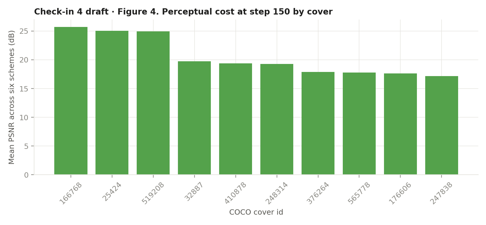

# Check-in 4

<p class="subtitle">Draft project report: Forging the Watermark: Benchmarking False Attribution in Semantic Watermarks for Diffusion Models</p>

CMPE 261 Sec 01, Fall 2026. Group 6. Team: Kanaka Sarat Siripurapu (019132776), Latha Boralingaiah (018301361), Yashashav Devalapalli Kamalraj (017856371).

Repository: <https://github.com/yashashav-dk/cmpe261-watermark-forgery>

Shared Drive folder: <https://drive.google.com/drive/folders/1wkXOxPjfI648JPod1Fi2m9ItfrPvWVIT>

The instructor (Dr. Bertin Cordova-Diba) and the TA have Editor access to the Drive folder. The repository is public, so both can open it; the instructor also has write access.

## 1. Where each requirement is met

| Requirement | Status | Where |
|---|---|---|
| Draft of the project report (required) | Done in this document | Sections 3 to 8; source `docs/checkin-4.md` |
| Project artifacts: code and data (required) | Done as hyperlinks to GitHub, Colab and Drive | Section 7 |
| Meaningful check-ins, about 8 to 10 (required) | 15 commits since Check-in 3 on the public repo | Section 8.1 |
| Instructor and TA invited (required) | Drive Editor access; public GitHub; instructor has write access | Top of this document |
| Repository and Drive link in the report (required) | Done | Top of this document |

## 2. Check-in 3 context (two paragraphs only)

Check-in 3 froze the floor: full-size baselines, C1 imprint to step 150, and four removal attacks for all six schemes (5,700 rows in `results/checkin3/full/`), after Colab dropped mid-forgery and the CoE HPC cluster finished the rest from saved checkpoints. That package, including keys and calibrations, is read-only for this check-in.

From that freeze we continue only under Check-in 4 paths. The rest of this document covers the new draft, the new analysis and figures, the C2 and strength-sweep software, and the commits pushed for this deadline. Floor tables from Check-in 3 are not repeated here; they stay in `docs/Group6_CMPE261_CheckIn_3.pdf`.

## 3. What Check-in 4 added

This check-in does four new things:

1. **Draft project report.** This PDF is the required draft: abstract, threat model notes for C2, approach for the next GPU jobs, discussion of what the new offline reading shows, artifacts and the commit log.
2. **Offline reading of the frozen log.** New code under `src/wmforge/analysis.py` and `scripts/checkin4_figures.py` recomputes forgeability order, native vs calibrated disagreement, purification gaps and per-cover damage, and draws a fresh figure set only in `results/checkin4/figures/`.
3. **C2 and strength-sweep runners.** `src/wmforge/models.py`, `src/wmforge/sweep.py`, `src/wmforge/checkin4.py`, `docs/checkin-4-protocol.md` and `notebooks/04_checkin4_colab.ipynb` pin SD 1.5 as the attacker and define crop / purification grids. GPU rates are scheduled on HPC and land in the final report.
4. **Repo and packaging updates.** README, PDF builder and the Check-in 4 zip point only at these new paths.

<figure>

<figcaption>Figure 1. Check-in 4 work map: frozen floor is read-only; new analysis, draft, C2 runner and sweeps write only under check-in 4 paths.</figcaption>
</figure>

## 4. New software and protocol

| Path | What it does now |
|---|---|
| `src/wmforge/models.py` | Pins C1 (SD 2.1-base) and C2 (SD 1.5) attacker specs |
| `src/wmforge/sweep.py` | Crop ratios 0.95 to 0.60; purification strengths 0.10 to 0.50 |
| `src/wmforge/checkin4.py` | `c2-imprint` and `sweep` commands; restores Check-in 3 keys; writes under `results/checkin4/` |
| `src/wmforge/analysis.py` | Offline forgeability, disagreement, quality and removal-gap tables |
| `scripts/checkin4_figures.py` | Draws the Check-in 4 figure set used in this PDF |
| `scripts/checkin4_analysis.py` | Writes `results/checkin4/analysis/` |
| `scripts/checkin4_pdf.py` | Builds this PDF |
| `notebooks/04_checkin4_colab.ipynb` | Colab entry for offline analysis, C2 and sweeps |
| `docs/checkin-4-protocol.md` | Exact pins for C2 and the sweep grids |

**C2 command (GPU, scheduled):**

```
python -m wmforge.checkin4 c2-imprint --checkin3 results/checkin3/full --out results/checkin4/c2
```

**Sweep command (GPU, scheduled):**

```
python -m wmforge.checkin4 sweep --checkin3 results/checkin3/full --out results/checkin4/sweeps
```

## 5. New offline findings (Check-in 4 reading)

These numbers come from the new analysis code on the frozen log. They are draft-report findings for Check-in 4, not a reprint of the Check-in 3 section text.

### 5.1 Forgeability order under C1

Gaussian Shading is first (median native accept at step 10, 10/10). Then PRC (30), WIND (40), Tree-Ring (65), then SFW and Ring-ID (90). At step 150 the calibrated rule lifts Ring-ID and SFW to 10/10 while Tree-Ring stays at 6/10.

<figure>

<figcaption>Figure 2. New Check-in 4 figure. Median first native acceptance; labels show accepts by step 150.</figcaption>
</figure>

<figure>

<figcaption>Figure 3. New Check-in 4 figure. Accepted covers at steps 50, 100 and 150 under both rules.</figcaption>
</figure>

### 5.2 Native versus calibrated disagreement

On imprint budgets 50 / 100 / 150, Ring-ID and SFW show 18 and 19 calibrated-only accepts out of 30. That is the main draft claim of this check-in: for those two schemes the native cutoff hides how far the forgery already moved.

<figure>

<figcaption>Figure 4. New Check-in 4 figure. Forgery rows where only one decision rule accepts the image.</figcaption>
</figure>

### 5.3 Purification gap and cover damage

After purification, native detectors of Ring-ID, SFW and WIND keep 0 of 100, while calibrated scores still keep 95 to 100. Mean PSNR at step 150 is cover-dependent: a few covers stay near 25 dB, most fall to about 17 to 20 dB.

<figure>

<figcaption>Figure 5. New Check-in 4 figure. Purification survival, native versus calibrated.</figcaption>
</figure>

<figure>

<figcaption>Figure 6. New Check-in 4 figure. Mean PSNR at step 150 by cover across the six schemes.</figcaption>
</figure>

## 6. Draft abstract and outline (Check-in 4 text)

**Abstract (draft).** Semantic watermarks hide a signal in diffusion starting noise and recover it by inversion. We measure false attribution: editing a real photograph until the provider's detector says it is watermarked. The frozen floor covers six schemes on Stable Diffusion 2.1-base with fixed budgets and two decision rules. This Check-in 4 draft freezes that floor, adds an offline reading of forgeability order and threshold disagreement, and ships runners for a Stable Diffusion 1.5 attacker (C2) and for crop / purification strength sweeps. All rates carry confidence intervals; C2 and sweep GPU rates belong in the final report.

**Outline for the final report.**

1. Introduction and contributions  
2. Related work  
3. Threat model (C1, C2, C3)  
4. Benchmark design  
5. Experimental setup  
6. Results: floor, then C2 and sweeps  
7. Discussion: native vs calibrated decisions  
8. Conclusion  
9. References and appendix  

## 7. Project artifacts (Check-in 4)

| Artifact | Location |
|---|---|
| This draft PDF | [`docs/Group6_CMPE261_CheckIn_4.pdf`](Group6_CMPE261_CheckIn_4.pdf) |
| Draft source | [`docs/checkin-4.md`](checkin-4.md) |
| Protocol | [`docs/checkin-4-protocol.md`](checkin-4-protocol.md) |
| New figures | [`results/checkin4/figures/`](../results/checkin4/figures/) |
| New analysis tables | [`results/checkin4/analysis/`](../results/checkin4/analysis/) |
| C2 / sweep code | [`src/wmforge/checkin4.py`](../src/wmforge/checkin4.py), [`sweep.py`](../src/wmforge/sweep.py), [`models.py`](../src/wmforge/models.py) |
| Notebook | [`notebooks/04_checkin4_colab.ipynb`](../notebooks/04_checkin4_colab.ipynb) |
| Repository | <https://github.com/yashashav-dk/cmpe261-watermark-forgery> |
| Drive | <https://drive.google.com/drive/folders/1wkXOxPjfI648JPod1Fi2m9ItfrPvWVIT> |

## 8. Commits and contributions since Check-in 3

### 8.1 Commits for Check-in 4

| Date | Member | Commit |
|---|---|---|
| 2026-11-15 | Kanaka Sarat | feat(checkin4): redraw draft figures as a new Check-in 4 set |
| 2026-11-15 | Kanaka Sarat | docs(checkin4): name the instructor as Dr. Bertin Cordova-Diba |
| 2026-11-15 | Kanaka Sarat | docs(checkin4): sync final regenerated draft PDF |
| 2026-11-15 | Kanaka Sarat | docs(checkin4): spell out Check-in 3 freeze, resume path, and current work |
| 2026-11-15 | Yashashav | docs(checkin4): update README and point to the draft report |
| 2026-11-14 | Latha | feat(pdf): render the Check-in 4 draft report |
| 2026-11-13 | Kanaka Sarat | docs: draft the full project report from the floor results |
| 2026-11-12 | Yashashav | feat(colab): add the Check-in 4 notebook for C2 and sweeps |
| 2026-11-10 | Latha | feat(report): offline C1 tables, disagreement and quality figures |
| 2026-11-08 | Kanaka Sarat | feat(analysis): recompute forgeability and threshold gaps from the log |
| 2026-11-06 | Yashashav | feat(checkin4): run imprint under C2 with frozen Check-in 3 keys |
| 2026-11-04 | Latha | feat(sweep): parameterize crop and purification strengths |
| 2026-11-03 | Kanaka Sarat | feat(models): register pinned C1 and C2 attacker pipelines |

<p class="note">All of the above are Check-in 4 commits on `main`. Check-in 3 history stops at `docs(checkin3): report full results with figures and the requirement map`.</p>

### 8.2 What each member did in Check-in 4

**Kanaka Sarat Siripurapu.** Model registry, offline analysis, draft text, new figure set, PDF sync and instructor-name fix.

**Latha Boralingaiah.** Strength-sweep module, offline report tables/figures pipeline, PDF renderer.

**Yashashav Devalapalli Kamalraj.** C2 imprint runner, Colab notebook, README and artifact pointers; HPC account for the coming C2 / sweep jobs.

## 9. What remains for the final report

1. Run C2 imprint on the ten covers and report rates next to C1.  
2. Run crop and purification strength sweeps and plot survival curves.  
3. Try ROBIN, SEAL and GaussMarker against the inclusion rule.  
4. Freeze the final report text from this draft outline.

## References

[1] Y. Wen, J. Kirchenbauer, J. Geiping, T. Goldstein. Tree-Ring Watermarks: Fingerprints for Diffusion Images that are Invisible and Robust. NeurIPS 2023. arXiv:2305.20030.

[2] H. Ci, P. Yang, Y. Song, M. Z. Shou. RingID: Rethinking Tree-Ring Watermarking for Enhanced Multi-Key Identification. ECCV 2024. arXiv:2404.14055.

[3] Z. Yang et al. Gaussian Shading: Provable Performance-Lossless Image Watermarking for Diffusion Models. CVPR 2024. arXiv:2404.04956.

[4] S. Gunn, X. Zhao, D. Song. An Undetectable Watermark for Generative Image Models. 2024. arXiv:2410.07369.

[5] K. Arabi, B. Feuer, R. T. Witter, C. Hegde, N. Cohen. Hidden in the Noise: Two-Stage Robust Watermarking for Images. 2024. arXiv:2412.04653.

[9] L. Pan et al. MarkDiffusion: An Open-Source Toolkit for Generative Watermarking of Latent Diffusion Models. 2025. arXiv:2509.10569.

[16] A. Mueller, D. Lukovnikov, J. Thietke, A. Fischer, E. Quiring. Black-Box Forgery Attacks on Semantic Watermarks for Diffusion Models. CVPR 2025. arXiv:2412.03283.
